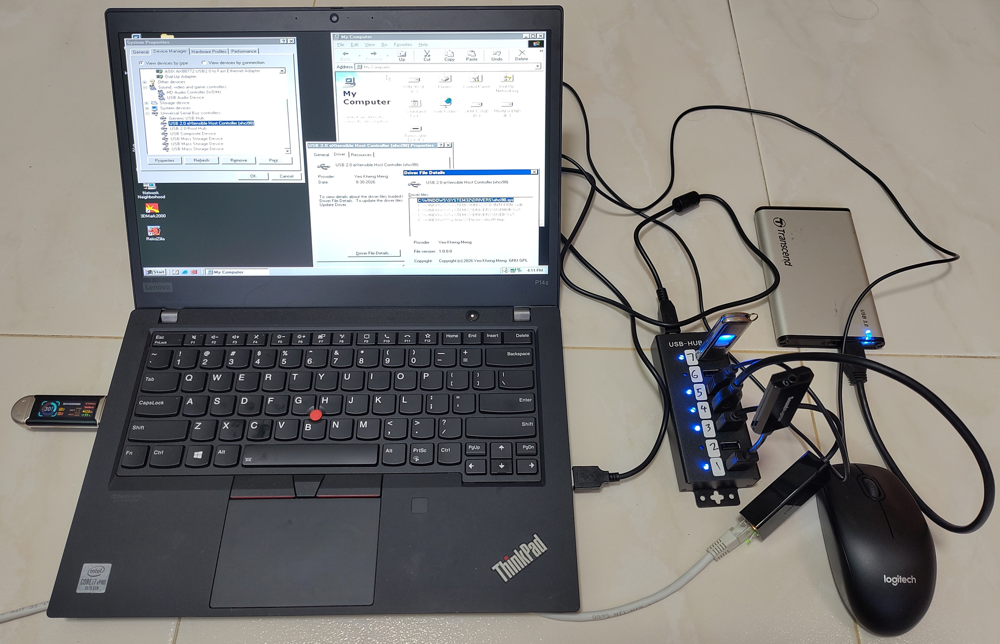
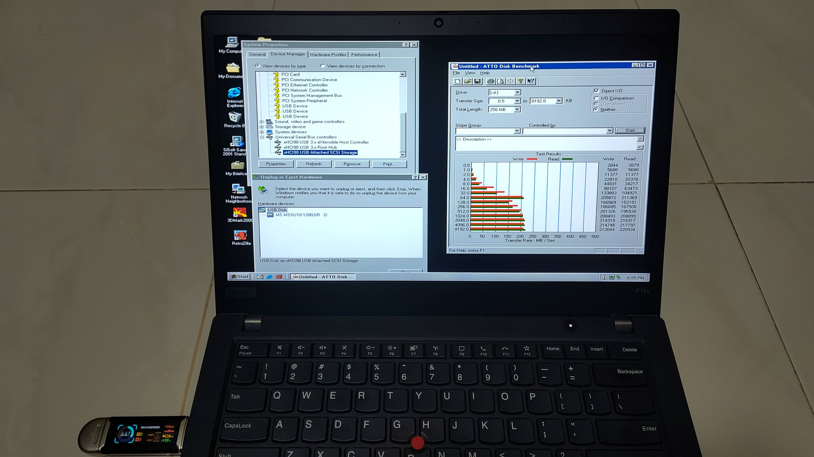
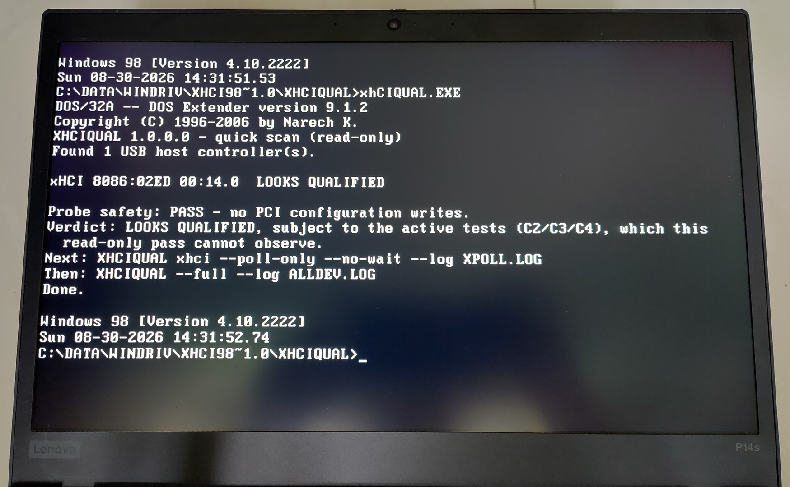
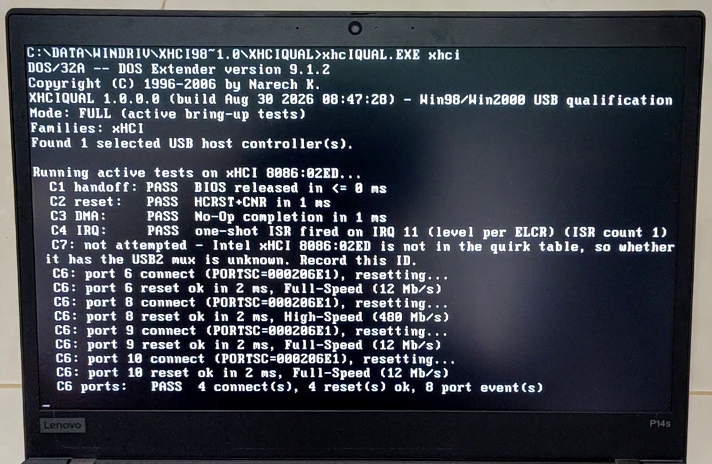
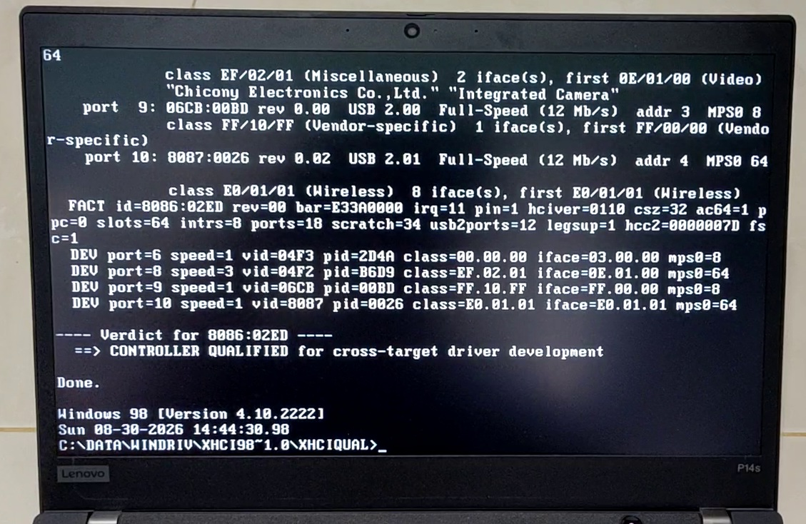
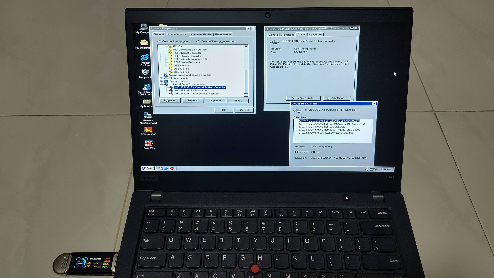

# xhci98

This project xHCI98 is a USB host controller driver (HCD) for xHCI host controllers. It supports Windows 98 SE, ME, 2000, XP (x86/x64), Vista (x86/x64) and 7 (x86/x64).

The driver replaces Windows' own USB port and hub drivers with its own, so it is not limited to USB 2.0. It drives:

- SuperSpeed (USB 3.x) devices on the root ports
- SuperSpeed hubs
- USB 2.0 and 1.1 (High, Full and Low Speed) devices and hubs
- UAS (USB Attached SCSI) storage, through a second driver, `xhciuas.sys`

This driver is developed based on Intel's xHCI specification and tested mainly on Intel machines so far.

No guarantees have been made on xHCI implementations from other vendors, although best effort has been made to ensure compatibility. [Omores](https://www.youtube.com/@O_mores) has also [tested 1.x](https://www.reddit.com/r/windows98/comments/1whzyoa/xhci98_windows_98_gets_usb_3x_controller_support/) on some AMD AM4 and AM5 platforms.

This project is from a solo human with AI-assistance only so bugs are not unexpected. Feel free to report them if you encounter any issues.



This is my 2020 ThinkPad P14s Gen 1 (Comet Lake xHCI, no EHCI) on Windows 98 SE, taken with the 1.x driver. Connected devices are 7-port hub, USB Ethernet, USB Audio, a USB-to-SATA bridge, two flash drives and a mouse all using the xHCI controller.

Video by [Omores](https://www.youtube.com/@O_mores) featuring this driver:

[](https://www.youtube.com/watch?v=7SOyvvC7P4E)

My personal demo video: https://www.youtube.com/watch?v=AU77f9CSbYc

Blog post of this project: https://yeokhengmeng.com/2026/08/xhci98-usb-host-driver/

## Motivation

Modern PCs from the mid-2010s onwards use xHCI-only USB chipsets. Windows 98 shipped with UHCI/OHCI drivers (USB 1.1) and gained EHCI (USB 2.0) through the back-ported stack in NUSB. Windows 2000 gained EHCI natively in SP4.

Neither has native xHCI support at all so even basic devices like keyboards, mice and flash drives do not work out of the box without BIOS support. Even with BIOS support, those devices cannot be hotplugged and other devices like Ethernet and Audio are not supported. Windows 7 is no better, having no USB 3 stack of its own.

This project attempts to fill that gap.

## SuperSpeed and UAS



My ThinkPad P14s Gen 1 under Windows 98 SE with NUSB, the MSSU10-128GSR flash drive at SuperSpeed through `xhciuas.sys`. Device Manager shows the controller, its root hub and the UAS storage device, and the drive is listed under Unplug or Eject Hardware.

ATTO Disk Benchmark (Direct I/O) reads about 201 to 215 MB/s write and 196 to 221 MB/s read from 512 KB transfers upward.

Some things to know:

- A UAS-capable drive gets UAS, and anything else gets Windows' own `usbstor.sys` (Bulk-Only), at whatever speed it connects. A drive that offers both can be forced to Bulk-Only (see "Tuning" below).
- Device Manager and the other Windows tools on these systems may show a SuperSpeed device as High Speed at most. The interface they read predates SuperSpeed.

## Installation Steps

The prerequisites per OS:

- **Windows 98 SE**:
  - Install [NUSB 3.3 or 3.6](https://www.philscomputerlab.com/windows-98-usb-storage-driver.html) if you want USB storage, UAS included.
  - [SweetLow's stack](http://sweetlow.orgfree.com/download/usb20_win9x.zip) also works but has no storage driver. Unzip, right-click the `USB2.INF` at its root then install. With it alone, a USB stick shows Code 28 and a UAS drive Code 2, so storage still needs NUSB's storage files (below).
  - With neither, HID and audio devices work but storage has no driver.
  - Reboot if requested after installing either.
- **Windows ME**: Use [SweetLow's stack](http://sweetlow.orgfree.com/download/usb20_win9x.zip). ME has its own storage files. An ordinary USB stick needs to be plugged for the first time to copy the drivers before a UAS drive will be recognised.
- **Windows 2000 SP4, XP SP3 x86**: Nothing to install.
- **Windows XP SP2 x64, Vista SP2 and 7 SP1 (x86/x64)**: Nothing to install. On **Vista x64 and 7 x64** the driver is test-signed by me, so Windows has to be in test-signing mode, or driver signature enforcement disabled at every boot; see "Windows Vista x64 and 7 x64: test-signing mode" below.

On Windows 98 SE, storage of any kind, UAS included, needs NUSB's mass-storage component: `USBSTOR.INF`/`USBSTOR.SYS`, `USBNTMAP.INF`/`USBNTMAP.SYS` and `USBMPHLP.PDR`, which NUSB 3.3 and 3.6 install. SweetLow's stack alone has no storage half. 

On an xHCI-only Windows 98 SE or ME machine, **have the Windows installation CD at hand** or its contents on disk. Windows may ask for files from it while installing the driver or the USB devices plugged in afterwards.

Optional but recommended: boot real DOS (not a DOS box inside Windows) and run `XHCIQUAL` from the `XHCIQUAL\` folder. It says whether the driver can work on the machine before you install anything. A controller reporting no legacy interrupt pin is not refused: the driver polls it, or takes a message-signalled interrupt on Vista and 7, and `XHCIQUAL` reports it as `QUALIFIED WITH CAVEATS`.



Basic read-only quick scan answers in one line. The `xhci` run below it exercises the controller (handoff, reset, DMA, interrupt, port resets) and ends with a verdict:



Running the full check.



Controller qualified verdict.

XHCIQUAL demo video: https://www.youtube.com/watch?v=Tv6blmBS6Do

To submit logs with a [bug or hardware report](https://github.com/yeokm1/xhci98/issues/new/choose), run these from real DOS and attach `FULL.LOG` if the second run finished, or `PROBE.LOG` only if it did not:

1. `XHCIQUAL --probe-only --no-page --log PROBE.LOG` is read-only. It takes ownership of nothing and writes no PCI configuration register.
2. If that does not crash the machine, continue with `XHCIQUAL --no-page --log FULL.LOG`. This one **takes over the controller**, resets it and resets its ports. Use a PS/2 keyboard and do not write the log to a drive on the controller being tested.

### The package

| Directory | For | Contents |
|---|---|---|
| `release-x86\` | 32-bit Windows: 98 SE, ME, 2000, XP, Vista, 7 | the drivers, the helper and the extras below |
| `release-x64\` | 64-bit Windows: XP x64, Vista x64, 7 x64 | the same, without `xhcimsi.sys`, plus `xhci98-test.cer` |
| `debug-x86\`, `debug-x64\` | troubleshooting only | the same drivers built for troubleshooting; install only if asked |
| `xhciqual\` | DOS | `XHCIQUAL.EXE`, the qualifier |
| `xhcisnap\` | Windows | `XHCISNAP.EXE`, the log snapshot reader |
| `readme.txt` | | the release notes in plain text |

In each driver directory:

- `xhci98.sys` and `xhci98.inf`: the controller driver.
- `xhciuas.sys` and `xhciuas.inf`: the UAS storage driver.
- `xhcimsi.sys` (32-bit only): the MSI helper. 32-bit Vista and 7 need this small second driver to give the controller a message-signalled interrupt. The INF installs it on those two systems only, as a service that starts at boot, which is why they ask for a restart. Every other system ignores it.
- `txtsetup.oem`: for F6 during Windows 2000 or XP Setup.
- `portsw.vbs`: the switch for the Intel port switchover.
- `xhci98-test.cer` (64-bit only): the public half of the test certificate the x64 drivers are signed with. You do not need to import it.

`release-x86\` or `release-x64\` is the one to install.

### Install

1. Put the unzipped package somewhere the machine can read: a floppy, a CD, a shared folder.
2. Install the prerequisites above. On Windows 98 SE the order for a fresh install is NUSB, then xhci98, then the UAS disk.
3. In Device Manager, find the unrecognised xHCI controller. It sits unclaimed with a yellow mark, usually under "Other devices" such as "Universal Serial Bus Controller".
4. Properties -> Driver -> Update Driver -> Specify a location/Have Disk -> the `release-x86\` or `release-x64\` directory.
5. It installs as "xHCI98 USB 3.x eXtensible Host Controller" with "xHCI98 USB 3.x Root Hub" underneath it. Windows 98 SE may ask for its CD for `usbd.sys`.
6. Reboot if requested.
7. Plug in a UAS disk, and when the wizard asks for "xHCI98 USB Attached SCSI Storage", point it at the same directory. No restart is needed for `xhciuas.sys`.
8. An external hub installs as "xHCI98 USB Hub" from the driver already installed. On Windows 98 SE and 2000 it installs with nothing to answer. On Windows XP every newly plugged hub brings the Found New Hardware wizard and the unsigned-driver warning (Continue Anyway).

### Windows Vista x64 and 7 x64: test-signing mode

The 64-bit `xhci98.sys` and `xhciuas.sys` are test-signed, so on Windows Vista x64 and Windows 7 x64 the driver can run in test-signing mode instead of disabling driver signature enforcement with F8 at every boot. Once:

1. Open an elevated Command Prompt: Start, type `cmd`, right-click it, Run as administrator.
2. `bcdedit /set testsigning on` - a boot setting of the current Windows entry, so it stays on for every boot until it is turned off; no F8 is needed.
3. Restart. "Test Mode" (with the Windows version and build) appears in a corner of the desktop while it is on.
4. Install the driver as above. Windows still says it cannot verify the publisher; choose "Install this driver software anyway".

Check: `bcdedit /enum {current}` shows `testsigning Yes`. Turn it off: `bcdedit /set testsigning off` and restart; the driver then needs F8 again, or it does not load and the controller shows Code 39.

- With BitLocker on the system drive, suspend BitLocker before changing the boot setting, or the next boot asks for the recovery key.
- This is not Microsoft signing: the certificate is the project's own test certificate, which no Windows trusts by itself.
- F8 -> "Disable Driver Signature Enforcement" still works as before, for one boot, without test mode.

### Installing Windows 2000 or XP, or using the Recovery Console

This is for a machine whose keyboard or install medium is on the xHCI controller.

1. Copy the files of `release-x86\` (`release-x64\` for XP x64) to the root of a floppy.
2. Press F6 when text-mode Setup offers it.
3. Press S and pick "xHCI98 USB 3.x Host Controller".

The same floppy serves the Recovery Console of Windows 2000 and XP. Press F6 as for an install, then R at Setup's Welcome screen (on Windows 2000, then C for the console). The USB keyboard logs in and types commands.

Things to know:

- Pressing F6 needs the BIOS's own USB keyboard support.
- A UAS disk is not usable until GUI-mode Setup; a plain USB flash stick is.
- A USB drive present at the partition screen takes `C:`. Unplug the USB drives you do not need, or Windows installs to the next letter.
- On Windows 2000, plug the USB keyboard and stick in before Setup starts.
- To install Windows XP and XP x64, have a PS/2 keyboard or a laptop's built-in keyboard at hand. Later in Setup the USB keyboard does not work until a step that first asks about this unsigned driver (see "Known limitations/issues"). The Recovery Console runs in text mode throughout and is not affected.

The [release notes](docs/using/release-notes.md) have the limits.



The controller in Device Manager on the P14s Gen 1 under Windows 98 SE.

### Upgrading the driver
Install the new version over the old one with Update Driver on "xHCI98 USB 3.x eXtensible Host Controller", then on "xHCI98 USB 3.x Root Hub", both pointed at the `release-x86\` or `release-x64\` directory.

- **Windows 98 SE and ME: restart afterwards, although Windows does not ask.** The new file waits to replace the old one at the next start, and until then the old driver keeps running. Under SweetLow's stack the controller may show a problem for a minute or two after Finish. On ME it shows one until the restart, while the devices keep working.
- **Windows 2000: use Have Disk.** Letting Windows search answers that a suitable driver is already installed and keeps the old one. Use Driver -> Update Driver -> "Display a list of the known drivers" -> Have Disk -> the `release-x86\` directory, and pick "xHCI98 USB 3.x eXtensible Host Controller", the first of the three models listed.
- **XP, XP x64, Vista and 7**: the update takes effect at once with no restart, after one unsigned-driver warning; except on 32-bit Vista and 7, where it asks for a restart, for the MSI helper `xhcimsi.sys`. On Vista x64 and 7 x64 the new driver, like the first install, runs in test-signing mode or on a start with driver signature enforcement disabled.

Afterwards the root hub's Driver tab still shows the old version (on 98 SE and ME, its date), although it runs the new file. To change it, run Update Driver on "xHCI98 USB 3.x Root Hub" too:

- On Vista and 7, "Let me pick from a list of device drivers on my computer" and the new version's entry.

If Windows finds a device again as new hardware after the upgrade, apply its hidusbf setting again.

### Updating xhciuas.sys over an older one

When the package's `xhciuas.sys` carries the same `DriverVer` as the one installed, "Search for a better driver" keeps the cached INF.

Instead, Update Driver on "xHCI98 USB Attached SCSI Storage", choose "Display a list of all the drivers in a specific location", then Have Disk -> the package directory.

## Tuning

Each value below is a `DWORD` in the controller's driver (software) key. Here is where to find the key:

| Windows | Key |
|---|---|
| 98 SE, ME | `HKLM\System\CurrentControlSet\Services\Class\USB\NNNN` |
| 2000, XP, Vista, 7 (x86/x64) | `HKLM\SYSTEM\CurrentControlSet\Control\Class\{36FC9E60-C465-11CF-8056-444553540000}\NNNN` |

`NNNN` is the subkey whose `DriverDesc` is "xHCI98 USB 3.x eXtensible Host Controller". The number varies from machine to machine.

| Value | What it sets | Minimum | Maximum | Default when absent | Written by the install |
|---|---|---|---|---|---|
| `XhciImodInterval250ns` | The interrupt moderation interval | `10` | `4000` | `4000` | `160` |
| `XhciForceBulkOnly` | Bulk-Only instead of UAS | `0` | `1` | `0` | `0` |
| `XhciFastPollFsLs` | A root-port Low- or Full-Speed mouse polled above 1000 Hz | `0` | `4` | `0` | `0` |
| `XhciFirstEnumWaitMs` | The longest wait for a hub's first report | `0` | `30000` | `5000` | `5000` |
| `XhciFirstEnumPortMs` | The longest one port may hold that wait | `0` | `XhciFirstEnumWaitMs` | `2000` | `2000` |
| `XhciIntelPortSwitch` | The Intel 7/8/9-series port switchover; `1` turns it on, `2` applies it to any Intel controller **at your own risk** (`portsw.vbs` sets `0` or `1`) | `0` | `2` | `0` | `0` |
| `XhciIntelIrqRoute` | The Intel 7/8/9-series interrupt routing repair; `1` the Dell Latitude E7250 only, `2` any reviewed Intel chipset, `0` report only | `0` | `2` | `1` | `1` |
| `XhciTolerance` | The handling of controller faults, all together; `0` turns most of it off (see "Controller faults") | `0` | `1` | `1` | `1` |
| `XhciIntervalCap` | Interrupt endpoints polled at least every 32 ms: `1` on AMD controllers, `2` on every controller, `0` off | `0` | `2` | `1` | `1` |
| `XhciAvgTrbEsit` | A comparison switch for interrupt endpoints; leave at `0` unless comparing | `0` | `1` | `0` | `0` |
| `XhciMaxTransferKB` | The largest UAS command, in KiB (a multiple of `4`) | `64` | `2048` | `1024` | `1024` |
| `XhciInterruptMode` | How the controller's events arrive: `0` automatic, `1` the interrupt line only (on Vista and 7, if Windows still assigns a message-signalled interrupt, for example because the controller has no line, the driver uses it rather than fail to start), `2` polling | `0` | `2` | `0` | `0` |
| `XhciPollIdleMs` | While polling, the period with nothing outstanding, in ms | `1` | `5000` | `50` | `50` |
| `XhciPollActiveMs` | While polling, the shortest period with transfers outstanding, in ms (with only a mouse's or keyboard's periodic transfers outstanding, the endpoint's interval is used, held between this and the idle period) | `1` | `XhciPollIdleMs` | `1` | `1` |
| `XhciWideMap` | Two pieces of a large bulk transfer on the controller at once (2000 to 7) | `0` | `1` | `0` | not written |
| `XhciSelectiveSuspend` | Selective suspend of idle devices when Windows asks | `0` | `1` | `0` | not written |
| `XhciUsb2HubSpeedFallback` | The standard speed ID for a Low- or Full-Speed device behind a hub where the controller's USB 2.0 speed table names neither (the VIA VL805); `0` turns it off | `0` | `1` | `1` | not written |
| `XhciLogVerbosity` | The driver's log, read by `XHCISNAP` | `0` | `4` | `0` | `0` |
| `XhciLogDebugView` | The log sent to DebugView as well | `0` | `1` | `0` | `0` |

An install or update writes a value only where it is missing, so a value you changed stays as you set it. To go back to the table's value, set it by hand, or delete the value and update the driver.

The two log values are described in the [release notes](docs/using/release-notes.md), "The log, and how to send one". `XhciWideMap`, `XhciSelectiveSuspend` and `XhciUsb2HubSpeedFallback` are written by no install: add them by hand in the same key. Each value but `XhciForceBulkOnly` (read as each device is enumerated; see below) is read when the controller starts, so restart Windows after changing one. The others are described below, and all of them in the release notes' "Registry settings".

### The interrupt moderation interval

`XhciImodInterval250ns` sets the shortest gap the controller leaves between two interrupts, in units of 250 ns. A shorter gap makes USB storage faster at the cost of more interrupts.

- `160` (written by the install): 40 us, at most 25,000 interrupts a second. Linux uses the same value.
- `10` (the lowest accepted): 2.5 us.
- `4000`: 1 ms, the controller's own power-on value. It is also used when the value is missing, unreadable or outside `10`-`4000`.

A value out of range is replaced by `4000`, not rounded to the nearest limit, so a mistyped `0` cannot turn moderation off. If you get audio stutter or instability under load, raise it towards `4000` or delete it.

On my P14s with the MSSU10 over UAS (Windows 98 SE, 8 MB transfers), `500` gave about 181 MB/s, `160` gave 211 MB/s write and 221 MB/s read, and `40` added only 1 to 3% more.

### Forcing Bulk-Only instead of UAS

`XhciForceBulkOnly` decides which transport a storage device that offers both uses.

- `0` (default): UAS wherever the device offers it.
- `1`: Bulk-Only (Windows' own `usbstor.sys`) on every such device on the controller.

A UAS-only device stays on UAS either way. The value is read each time a device enumerates, so unplug and replug the drive after changing it. On Windows 2000 and later, a drive already installed keeps its driver until you uninstall it in Device Manager and replug it.

### Polling a Low- or Full-Speed mouse above 1000 Hz

`XhciFastPollFsLs` polls a mouse faster than 1000 Hz, together with SweetLow's hidusbf. It is read when the controller starts, so restart after changing it.

- `0` (default): off.
- `2` or `3`: a mouse on a **root port**, set in hidusbf to "31 Hz" or "62 Hz", is polled at the rate below. A device behind a hub keeps its normal rate, and any root-port Low- or Full-Speed device that asks for 16 to 63 ms is polled faster too.

  | Value | "31 Hz" becomes | "62 Hz" becomes |
  |---|---|---|
  | `2` | 2000 Hz | 4000 Hz |
  | `3` | 4000 Hz | 8000 Hz |

- `4`: the rate the client chooses. An interrupt endpoint set to `128`, `129` or `130` is polled at 2000, 4000 or 8000 Hz, and every other interval as normal. It covers a Low- or Full-Speed device on a root port, and a High-Speed or SuperSpeed device at a root port or behind a hub.

With `4`, set the value and restart first, then set hidusbf (or another filter) to `128`, `129` or `130`. A device that itself asks for 128 to 130 ms is polled that fast too, and a code written without `4` set means 128 ms (Low or Full Speed) or 4.096 s (High Speed or SuperSpeed).

This is outside the xHCI specification, and untested ground. A controller that refuses it is caught, and the device falls back to its normal rate (every 1 ms for a `4` code). A controller that accepts it and then misbehaves cannot be caught.

### The first report's wait

When the root hub or an external hub first reports its devices, the driver waits for the devices already plugged in to be ready, so Windows 2000's text-mode Setup sees them.

- `XhciFirstEnumWaitMs`: the longest wait, in ms. Default `5000`, at most `30000`; `0` turns it off.
- `XhciFirstEnumPortMs`: the longest one port may hold that wait. Default `2000`, held to the total.

With the defaults, the root hub's first report typically comes 20 to 30 ms after its start with nothing plugged in, and 0.3 to 0.9 s after it with a mouse and a stick.

### The Intel 7/8/9-series port switchover

On Intel 7-, 8- and 9-series chipsets (Ivy Bridge to Broadwell) and C610/X99, each switchable connector, usually a blue one, is wired to both the USB 2.0 (EHCI) and the xHCI controller. With the firmware's USB 3.0 setting on Auto, or no setting at all, those connectors start on the USB 2.0 controller.

`XhciIntelPortSwitch` lets the driver move them to the xHCI controller at each start and resume, and hand them back when the controller is disabled or removed, or the machine shuts down. The hand-back writes only the registers the driver itself wrote.

- `0` (default; also absent or not a `DWORD`): off.
- `1`: on, for Intel xHCI device ids `1E31`, `8C31`, `9C31`, `8CB1`, `9CB1` and `8D31`.
- `2`: on any Intel xHCI controller, listed or not; on a listed one it is the same as `1`. **At your own risk**: see below.

With `2`, on a chipset without these registers (every Intel chipset from the 100-series on, and any not yet read) the driver writes registers of unknown meaning, with unknown results. Use it only for an unlisted Intel chipset with both EHCI and xHCI.

A device on a switchable connector under a running USB 2.0 driver (NUSB's, for example) is disconnected there when this driver starts, and comes back under it, so do not have a drive busy on a blue connector at that moment.

The value is read when the controller starts, so restart Windows after changing it. `portsw.vbs`, in each package directory, shows the value on every xhci98 controller and sets it to `1` or `0`: double-click it, or run `cscript //nologo portsw.vbs show` (or `1`, or `0`) as an administrator.

### The Intel 7/8/9-series interrupt routing repair

On the same Intel chipsets, two chipset registers decide which interrupt line the xHCI controller's interrupt reaches. Some firmware points them at a different line from the one it tells Windows: the Dell Latitude E7250 sends it to IRQ 16 while Windows listens on IRQ 21, so every USB device on it is slow or stops.

`XhciIntelIrqRoute` lets the driver read those registers at each start and resume and point the interrupt at the line Windows assigned.

- `1` (default; also absent or any other value): only on the E7250 (`8086:9CB1`, subsystem `1028:062D`, chipset `9CC3`).
- `2`: on any of the six Intel controllers listed above, each with one of its own chipset ids.
- `0`: read and report only.

It writes nothing on any other controller, nothing when the interrupt is a message (MSI) rather than a line, nothing while the driver is polling the controller, and on 2000 to 7 nothing when Windows gave the controller an interrupt below 16.

### Polling and message-signalled interrupts

A controller with no interrupt pin is polled instead of refused, and so is one whose line the driver sees raised and never delivered. On Windows Vista and 7 the controller may use a message-signalled interrupt (MSI or MSI-X) instead of its line: on x64 directly, on 32-bit through the helper driver `xhcimsi.sys` in the package.

**The install and every update on 32-bit Vista and 7 ask for a restart**, because the helper starts only at boot. `XhciInterruptMode` chooses how the controller's events reach the driver.

- `0` (default, automatic): picks, in this order:
  1. On Vista and 7, a message-signalled interrupt, where Windows grants one and it connects.
  2. The controller's interrupt line, where it has one and Windows assigned it.
  3. Polling: no interrupt pin, none assigned, or a granted message that could not connect.
  4. After the start, a line the driver sees raised that never reaches it switches to polling by itself.
- `1`: the interrupt line only. A controller without one fails to start (Code 10) on 98 SE to XP, and on 32-bit Vista and 7 without the helper.
- `2`: always poll, at the cost of more processor wake-ups. Use it for an interrupt that fails in a way the driver cannot see in the controller's registers.

Two more values set the polling periods, in ms:

- `XhciPollIdleMs` (default `50`): with nothing outstanding.
- `XhciPollActiveMs` (default `1`): with transfers outstanding.

The release notes' "Windows Vista and 7: message-signalled interrupts" and "XhciInterruptMode, XhciPollIdleMs and XhciPollActiveMs" have the details.

### UAS command size and two transfer pieces at once

A UAS command moves up to 1 MiB by default. Restart after changing either value below.

- `XhciMaxTransferKB`: the largest UAS command for every UAS drive on the controller, `64` to `2048` KiB in multiples of `4`. Default `1024`.
- `XhciWideMap`: `1` keeps two pieces of a large bulk transfer on the controller at once, on Windows 2000 to 7. **Off by default** (`0`), because a regression would show as wrong data rather than an error.

Microsoft's per-device `MaximumTransferLength` under `HKLM\SYSTEM\CurrentControlSet\Control\usbstor\VVVVPPPP` (`65535` to `2097152` bytes) sets the command size for one drive model instead. The release notes, "XhciMaxTransferKB" and "XhciWideMap", have the details.

### Low- and Full-Speed devices behind a built-in hub

Some controllers reach Low- and Full-Speed devices only through a USB 2.0 hub built into the chip, and their USB 2.0 port's speed table names High Speed alone; the VIA VL805 (`1106:3483`) is one. Every mouse, keyboard and other Low- or Full-Speed device on such a controller sits behind that hub.

`XhciUsb2HubSpeedFallback` lets the driver give such a device the standard speed ID, Full Speed `1` or Low Speed `2`, when the table names neither speed and does not use that number for another.

- `1` (default): on.
- `0`: off; such devices are refused.

A controller whose table lists Low and Full Speed, or has no table, is not affected, and a device on a root port of its own is never given a fallback. Restart after changing it.

### Selective suspend

The driver can suspend an idle USB 2.0 or SuperSpeed device when Windows asks, and wake it on Windows' request or the device's own remote wake. Hubs, the root hub and the controller are never suspended.

- `XhciSelectiveSuspend` `0` (default): off.
- `XhciSelectiveSuspend` `1`: on.

Restart after changing it. The release notes' "XhciSelectiveSuspend: putting idle devices to sleep" has the details.

### Controller faults

The driver does not leave a device dead until it is replugged after a transfer, port or controller fault. This follows a tester's report of a mouse that stopped at random on an AMD AM5 board. A missed interrupt is picked up by the driver itself, and a USB transaction error is retried up to three times before the transfer fails.

A fault the driver cannot tie to a transfer re-enumerates the device, as if it had been replugged. A USB 2.0 port the controller disabled, or one that reported an over-current, is brought back. A controller that halts is recovered, and one that stops answering is closed off safely.

Each is tried a few times at most; then the port or the controller is held until the device is unplugged or the controller is restarted. None of it acts unless a fault is reported.

- `XhciTolerance` `1` (default): on. `0` turns most of it off.
- `XhciIntervalCap`: interrupt endpoints polled at least every 32 ms. `1` (default) on AMD controllers, `2` on every controller, `0` off.
- `XhciAvgTrbEsit`: a comparison switch for interrupt endpoints. Leave it at `0` (default).

If a USB device stops working on your machine, send two `XHCISNAP` captures (one while it works, one after it stops) and the controller's id from `XHCIQUAL`. The [release notes](docs/using/release-notes.md), "Controller faults: what the driver does about them", and the package's `readme.txt` have the details, including the exceptions.

## What is tested, and what is not

Windows 98 SE and Windows 2000 SP4 are the primary targets. Windows 98 SE has also run on real hardware, the ThinkPad E460 and the ThinkPad P14s Gen 1; every other target, Windows 2000 included, has run in QEMU virtual machines only. The [release notes](docs/using/release-notes.md)' "Targets and their standing" has the full detail per system.

| Target | State |
|---|---|
| Windows 98 SE | VMs under NUSB and SweetLow's stack: HID, storage, composite audio, the ASIX Ethernet adapter, hubs to five tiers, plug soaks, SuperSpeed storage and UAS. A stock install runs HID and audio, with no storage driver. Real hardware: the E460 and the P14s Gen 1. |
| Windows 2000 SP4 | VMs only, under Driver Verifier and on a multiprocessor guest: the same as Windows 98 SE, including UAS and forced Bulk-Only. SuperSpeed hubs untested. |
| Windows ME | VMs only, under SweetLow's stack: HID, storage, hubs, composite audio, soaks, SuperSpeed storage and UAS. |
| Windows XP, 32-bit and x64 | VMs only: HID, storage, hubs, composite audio, disable and enable, soaks, SuperSpeed storage and UAS. |
| Windows Vista SP2 and 7 SP1, 32-bit and x64 | VMs only: the same, on four virtual processors. On the x64 systems, in test-signing mode or with driver signature enforcement disabled (F8). |
| The release package | `2.0.0.0` and `2.1.0.0` each installed from the release download on all ten systems and passed. `2.1.0.0` also installed over `2.0.0.0` on each. |

| Machine | Controller | Tested by |
|---|---|---|
| 2012 Lenovo B490 | Intel Ivy Bridge, Panther Point HM77 (7-series) PCH, with EHCI beside it. xHCI 1.0. | Me |
| 2016 ThinkPad E460 | Intel Skylake, Sunrise Point-LP (100-series) PCH. xHCI 1.0. | Me |
| 2020 ThinkPad P14s Gen 1 | Intel Comet Lake PCH-LP (400-series). xHCI 1.1. | Me |
| Omores' Intel and AMD desktops | H110, B360, B550, X570, X670 | [Omores](https://www.reddit.com/r/windows98/comments/1whzyoa/xhci98_windows_98_gets_usb_3x_controller_support/) (1.x.x.x) |

The devices, each characterised in [test-equipment.md](docs/contributing/test-equipment.md):

| Device | VID:PID | Speed |
|---|---|---|
| Terminus 7-port hub, multi-TT | `1A40:0201` | High |
| Terminus 4-port hub, single-TT | `1A40:0101` | High |
| Genesys 7-port hub (two cascaded chips), single-TT | `05E3:0608` | High |
| Genesys USB 3.0 hub | `05E3:0610`, `05E3:0612` | SuperSpeed and High |
| A Full-Speed hub behind a High-Speed hub | | Full |
| Logitech USB Optical Mouse | `046D:C077` | Low |
| Microsoft Wired Keyboard 600 (composite) | `045E:0750` | Low |
| SanDisk U3 Titanium flash drive | `0781:5408` | High |
| MSSU10-128GSR flash drive | `090C:2320` | SuperSpeed, UAS |
| SanDisk 3.2Gen1 flash drive | `0781:55AB` | SuperSpeed, Bulk-Only |
| StoreJet Transcend USB-to-SATA bridge (ASMedia) | `174C:5106` | SuperSpeed, UAS and Bulk-Only |
| ASIX AX88772A USB Ethernet | `0B95:7720` | High |
| Sound Blaster Play! 2 (UAC 1.0 composite) | `041E:323D` | Full |
| C-Media USB Audio Device (UAC 1.0 composite) | `0D8C:0014` | Full |

## Known limitations/issues

### Outside this driver's control

These come from Windows, NUSB or the driver being unsigned, and no change to this driver can remove them.

| Limitation | Detail |
|---|---|
| Vista x64 and 7 x64 need test-signing mode, or driver signature enforcement disabled | The x64 drivers carry the project's own test signature, not Microsoft's. Turn on test-signing mode once (see "Windows Vista x64 and 7 x64: test-signing mode"), or disable driver signature enforcement at every start (F8); otherwise the controller sits at Code 39. |
| No USB storage on a stock Windows 98 SE | With no NUSB installed there is no mass-storage driver at all. HID and audio still work. |
| Windows XP installed with the F6 floppy needs a PS/2 or built-in laptop keyboard | Setup copies Windows' own HID and USB helper files only with Microsoft's own USB controller drivers, so in GUI-mode Setup the USB keyboard and mouse wait for its device install, which first asks about the unsigned driver (default No). A USB-only keyboard cannot answer it; a PS/2 or built-in laptop keyboard can. Windows 2000 does not ask. |
| Windows ME: unplugging a device while Windows installs it | ME's own device manager stops responding if a device is unplugged while Windows is still installing its driver. ME does the same on Microsoft's own USB stack. Wait for the install to finish before unplugging. |

### Not planned, though a later release might address them

| Limitation | Detail |
|---|---|
| Windows 2000: a mounted USB drive may come back at Code 31 after a controller recovery or a resume from hibernation | After the driver recovers the controller in place (a halted controller, or a failed endpoint reset), a USB drive whose volume was mounted may stay at Code 31 until it is unplugged and plugged in again, or the controller is disabled and enabled. Other devices come back. Seen in a virtual machine; not on Windows 98 SE. The path predates `2.2.0.0`, which recovers on more faults. In `2.3.0.0`'s virtual-machine tests it was seen again after a recovery with the controller polled, and after a resume from hibernation on a controller that lost its state (QEMU's does), where the driver finds every device again; a restart of the drive's own device cleared it. |
| A UAS drive as the first USB storage device on Windows ME | On a fresh Windows ME installation whose first USB storage device is a UAS drive, the drive shows Code 2 (NTKERN.VXD device loader(s) could not load). ME has not yet copied its own `USBNTMAP.SYS` and `USBMPHLP.PDR`, which it installs only when its first ordinary USB stick is plugged in. To recover, plug in any ordinary USB stick once, then unplug the UAS drive and plug it back in. No Remove and no restart are needed. |

### Untested ground

| Area | State |
|---|---|
| SuperSpeed isochronous transfers | Built from the specification. No SuperSpeed isochronous device has been held and QEMU models none. |
| SuperSpeedPlus (USB 3.1 Gen 2, USB 3.2 Gen 1x2 and Gen 2x2) | Accepted at its trained rate, built from the specification. Not read on any hardware: no Gen 2 device has been tested, so every mode is untested. |
| A UAS-only drive at SuperSpeed on a controller without streams | It is sent back to its USB 2.0 port and runs UAS at High Speed, or is refused if it has no USB 2.0 port. Built from the specification; no such controller has been held. |
| Polling above 1000 Hz (`XhciFastPollFsLs`) | Outside the xHCI specification. Not read on any real controller or in any virtual machine. |
| Stand by on Windows 98 SE | Read only in QEMU virtual machines, where Windows 98 SE itself does not resume reliably, with or without a USB controller. With a USB disk attached the resume stopped before the desktop under this driver and under NUSB's EHCI driver alike; with a USB mouse alone, or behind a hub, it completed and the mouse worked. Untested on real hardware: remove USB disks before Stand by. See the release notes' "Known limitations". |
| The Intel port switchover beyond the B490 | Device ids `8C31`, `9C31`, `8CB1`, `9CB1` and `8D31`, systems other than Windows 98 SE, and standby. |

## Toolchain and building

The drivers are C (C89/C90, no C++ or CRT), built and verified on Windows 11 x64. The toolchain unpacks inside the repository (`tools/`, git-ignored) and installs nothing to `C:\`. Every script finds it relative to its own location, so a clone builds wherever it is unpacked.

1. Download the two toolchain archives into `tools\` under these exact names:

   | File | Source |
   |---|---|
   | `tools\MSVC600.zip` | MSVC 6.0 - [itsmattkc/MSVC600](https://github.com/itsmattkc/MSVC600) |
   | `tools\WIN2KDDK.EXE` | Windows 2000 DDK - [KunYi/WDK_DDKArchive](https://github.com/KunYi/WDK_DDKArchive/releases/tag/Win2K_DDK) |

   The 64-bit build needs a third, unpacked to `tools\WinDDK71`: WDK 7.1 (7600.16385.1), because no compiler older than its `cl` 15.00 can target x64. It is needed only for the amd64 package; a clone without it builds every 32-bit flavour.

2. Unpack them in place:

   ```powershell
   powershell -ExecutionPolicy Bypass -File scripts\setup-msvc6.ps1        # -> tools\MSVC600
   powershell -ExecutionPolicy Bypass -File scripts\install-w2kddk-cabs.ps1 # -> tools\ntddk
   ```

3. Build the drivers. `both` (the default) builds release and debug. `all` adds the emulator-only flavour, and is what a release cut uses. Each flavour builds `xhci98.sys` and then `xhciuas.sys`.

   ```
   scripts\build-driver.cmd both
   ```

   | Flavour | Output |
   |---|---|
   | `release` | `src\objfre\i386\xhci98.sys` and `src\uas\objfre\i386\xhciuas.sys` - the shipping drivers |
   | `debug` | `src\objchk\i386\xhci98.sys` and `src\uas\objchk\i386\xhciuas.sys` - the diagnostic builds, also shipped |
   | `qemu` | `src\objchk_qemu\i386\xhci98.sys` and `src\uas\objchk_qemu\i386\xhciuas.sys` - emulator-only, never published |

   Add `-amd64` for the 64-bit build, which is a **separate pair of binaries from a separate toolchain in a separate package** - no statement about "one binary" reaches it. The outputs are the same paths with `amd64` in place of `i386`.

   ```
   scripts\build-driver.cmd both -amd64
   ```

   Every build runs the gates, and any failure stops it:

   - the import, INF, packager, QEMU launcher and device-matrix self-tests;
   - the INF gates: `scripts\inf-gate\check-inf.ps1` on `src\xhci98.inf` and `src\xhci98-amd64.inf`, and `scripts\inf-gate\check-uas-inf.ps1` on `src\uas\xhciuas.inf` and `src\uas\xhciuas-amd64.inf`;
   - the batch-file line endings and the source charset gate (ASCII only, CRLF);
   - the host unit tests (`test\run-host-tests.cmd`), before any DDK build;
   - after each link, the import gate against each driver's own allowlist (`scripts\import-gate\xhci98-imports*.allow`, `xhciuas-imports*.allow`), the flavour-marker check and the source stamp.

   `-NoTargetEvidence` skips the import gate's target-file evidence steps on a clone that has no target files staged.

4. Build the two tools that ship beside the drivers:
   - `xhciqual\build.cmd` produces `XHCIQUAL.EXE`, the DOS qualifier. It needs [Open Watcom 2.0](https://github.com/open-watcom/open-watcom-v2/releases) at `C:\WATCOM` (or wherever `WATCOM` points), the only tool installed normally on the host; the drivers never use it.
   - `xhcisnap\build.cmd` produces `XHCISNAP.EXE`, the snapshot reader, with the in-repo MSVC 6.0.

5. Make install media. A `.sys` on its own is not install media; each INF travels with its driver, and nothing else does, because the controller's INF has Windows supply its own `usbd.sys` and `usbui.dll`.

   | Script | Output |
   |---|---|
   | `scripts\package\make-package.ps1` | `out\pkg-<flavour>-<arch>\` - both drivers and their INFs, media a VM or a machine can be pointed at |
   | `scripts\package\make-release.ps1` | `releases\<version>\` and `out\xhci98-<version>.zip` - the published cut, four directories, each with both drivers |

6. Test in QEMU with the `qemu-xhci` device: a Win98 SE guest, a Win2000 SP4 guest, and an SMP Win2000 guest for race detection, with `usb-storage` and `usb-uas` for SuperSpeed and UAS.

The version lives in [src/xhci_version.h](src/xhci_version.h). The `DriverVer` of all four INFs is a literal that the build's INF gates check against it. See [docs/contributing/build-and-test.md](docs/contributing/build-and-test.md) for the VM setup, versioning, packaging and the rest of the procedure.

## Repository Layout

```
src/            The host controller driver xhci98.sys (C), its two INFs and
                the DDK build files
  uas/          The UAS class driver xhciuas.sys, its two INFs and build files
test/           Host-side unit tests for the DDK-free core (test\run-host-tests.cmd)
scripts/        Setup helpers, build wrapper, the import/INF/packaging gates,
                and vm-matrix/ - the automated device matrix
xhciqual/       The DOS hardware-qualification tool (Open Watcom) and its
                bare-metal run logs under results/
xhcisnap/       The snapshot reader for the driver's log channel
docs/           Documentation, indexed by docs/README.md
  using/        The user-facing release notes and acceptance test
  contributing/ Roadmaps, architecture, build/test/runbooks, diagnostics,
                 invariants, provenance, and numbered design records
  usb-xhci-info/ xHCI programming/data structures, WDM constraints, and the
                 USBPORT ABI the 1.x miniport used
  references/   Fetch metadata for external specifications (downloads git-ignored)
releases/       The releases that have been cut, one directory per version
images/         Photographs of the driver on real hardware, used by this README
tools/          The build toolchain, unpacked in place (git-ignored)
external/       Local mirrors of the reference sources (git-ignored)
vm/             Guest images and per-run evidence (git-ignored)
out/            Staged install media from the packager (git-ignored)
.github/        Issue forms - the bug report and the hardware report
AGENTS.md       Guide for AI agents working on this project
```

## Documentation

Everything is under [docs/](docs/), indexed by [docs/README.md](docs/README.md).

Using the driver:

- [Release notes](docs/using/release-notes.md) - what the drivers do, do not, and do not yet claim, per target
- [Release acceptance test](docs/using/release-acceptance-test.md) - the fixed procedure for checking a release on a new machine
- [Release history](releases/history.md) - what each version changed

Working on the driver:

- [Build and test](docs/contributing/build-and-test.md) - toolchain setup, builds, VMs, install, debugging, packaging, recovery
- [Roadmap for 2.0.0.0 onward](docs/contributing/roadmap-hcd.md) - the host controller driver, Phases 25 onward, UAS in Phase 31; the 1.x miniport's [Phases 0-16](docs/contributing/roadmap.md) and [17-24](docs/contributing/roadmap-miniport-updates.md) are closed records
- [Design record 13](docs/contributing/design/13-superspeed-hcd.md) - the host controller driver: the bus, hubs and composite devices, the UAS id policy, the INFs and the package
- [Design records](docs/contributing/design/README.md) - the numbered design decisions
- [Architecture](docs/contributing/architecture.md) and [implementation invariants](docs/contributing/implementation-invariants.md)
- [Source files](docs/contributing/source-files.md) - what every file in `src/` is for
- [Failure diagnosis](docs/contributing/failure-diagnosis.md) and [measured lessons](docs/contributing/lessons.md) - read these before theorising about a failure
- [Test equipment, as measured](docs/contributing/test-equipment.md) - every hub and device used for hardware validation
- [Legal and provenance record](docs/contributing/legal-provenance.md)

The hardware and the Windows USB stack:

- [xHCI programming](docs/usb-xhci-info/xhci-programming.md) and [xHCI data structures](docs/usb-xhci-info/xhci-data-structures.md)
- [Windows 98/2000 WDM constraints](docs/usb-xhci-info/win98-wdm.md)
- [USBPORT miniport interface](docs/usb-xhci-info/usbport-miniport-interface.md) and [ABI](docs/usb-xhci-info/usbport-miniport-abi.md) - the undocumented contract the 1.x miniport plugged into

[AGENTS.md](AGENTS.md) is the guide for AI agents, and doubles as the short orientation for a human.

## AI usage

This project was developed with substantial help from AI coding agents, Claude Code (Claude Fable 5, Claude Opus 5 and Claude Opus 5.5) and OpenAI Codex (GPT 5.6 Sol). The agents wrote and revised code, tests and documentation under the guidance in [AGENTS.md](AGENTS.md).

Kheng Meng directed the work, ran the hardware validation on real machines and reviewed what went in.

## References

- [xHCI specification](https://www.intel.com/content/www/us/en/content-details/868295/extensible-host-controller-interface-for-universal-serial-bus-xhci-requirements-specification-r1-2c.html) (Intel), citations verified against revision 1.2c
- [USB 3.2 specification](https://www.usb.org/document-library/usb-32-revision-11-june-2022) (USB-IF), revision 1.1 (June 2022) with its ECNs - SuperSpeed, SuperSpeed hubs and the BOS descriptors, cited as `USB 3.2 p.N`
- [USB-IF xHCI backwards compatibility testing](https://www.usb.org/sites/default/files/xHCI_Backwards_Compatibility_Testing_v1_7.pdf) (v1.7)
- [How does USB stack enumerate a device?](https://techcommunity.microsoft.com/blog/microsoftusbblog/how-does-usb-stack-enumerate-a-device/270685) (Microsoft USB blog) - the Windows hub driver's enumeration steps, timeouts and retries, which the first-enumeration wait's defaults follow
- [ReactOS usbport](https://github.com/reactos/reactos/tree/master/drivers/usb/usbport) - primary reference for the `usbport.sys` miniport interface of the 1.x driver (undocumented by Microsoft)
- [Linux xhci-pci.c](https://github.com/torvalds/linux/blob/master/drivers/usb/host/xhci-pci.c) - controller quirk table
- [Haiku XHCI driver](https://github.com/haiku/haiku/blob/master/src/add-ons/kernel/busses/usb/xhci.cpp) and [FreeBSD xhci.c](https://github.com/freebsd/freebsd-src/blob/main/sys/dev/usb/controller/xhci.c) - second opinions on hardware details

None of these PDFs is tracked here. Fetch your own copies into the git-ignored `docs/references/`. [docs/references/README.md](docs/references/README.md) records the versions and SHA-256 sums. Mirrors of the source references can be fetched into `external/`. See [external/README.md](external/README.md).

## Licensing and provenance

This project's own source is licensed under the GNU General Public License, version 2 ([LICENSE](LICENSE)), `GPL-2.0-only`.

The repository tracks no third-party binary on its own, although the two tool executables it tracks under `releases/` carry statically linked third-party runtimes.

* `xhci98.sys` and `xhciuas.sys` link no runtime or extender. The 32-bit builds link no third-party object either; the 64-bit builds, linked by WDK 7.1, carry that kit's `/GS` stack-cookie handler (`__security_check_cookie` / `__report_gsfailure`), which nothing in this project's source calls.

* `XHCIQUAL.EXE` embeds the Open Watcom runtime and the DOS/32A extender.

* `XHCISNAP.EXE` embeds the MSVC 6.0 runtime.

Each tool ships with a `NOTICE.TXT` recording it, and the `LICENSE` scope note says that those runtimes carry their own terms and are outside the grant. Neither quotes the terms themselves.

The release download carries no Microsoft file. `usbd.sys` and `usbui.dll` are the OS's own, copied by Windows Setup from its own install source. On Windows 98, `xhciuas.inf` names NUSB's `USBNTMAP.SYS` as a filter on the UAS device; the file is named, never shipped, and NUSB's mass-storage install places it.

The full inventory, provenance methods and redistribution boundaries are in [docs/contributing/legal-provenance.md](docs/contributing/legal-provenance.md), which states facts, not legal conclusions.
