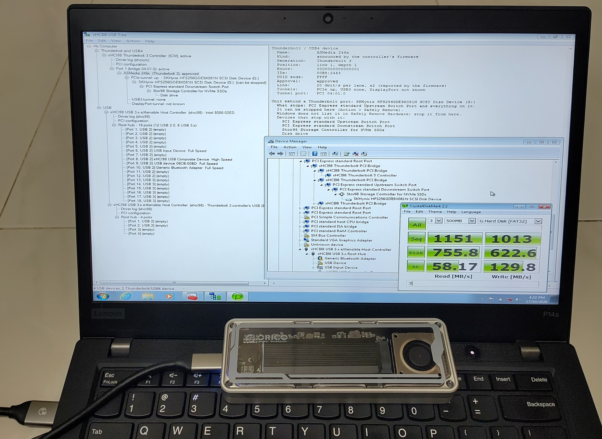
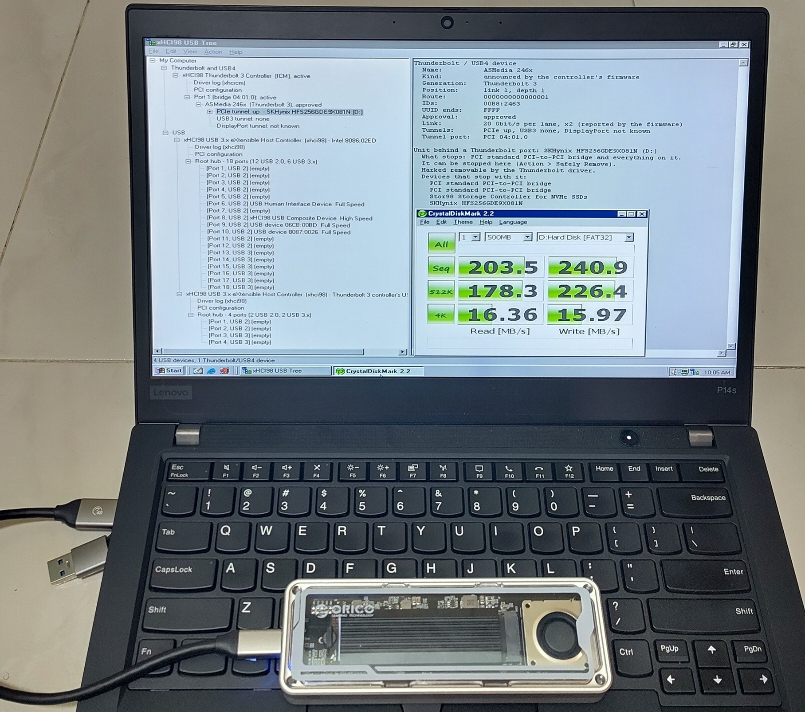

# xhci98

xHCI98 is a USB host controller driver (HCD) for xHCI (USB 3.x) controllers on Windows 98 SE, ME, 2000, XP (x86/x64), Vista (x86/x64) and 7 (x86/x64).

Experimental support for USB4 and Thunderbolt 3/4 is also included.

It replaces Windows' own USB port and hub drivers, so it is not limited to USB 2.0. It drives:

- SuperSpeed (USB 3.x) devices and hubs
- USB 2.0 and 1.1 (High, Full and Low Speed) devices and hubs
- UAS (USB Attached SCSI) storage, through a second driver, `xhciuas.sys`
- Thunderbolt 3 and USB4 docks and NVMe enclosures through a third driver, `xhcicm.sys`

It is built to Intel's xHCI specification and tested mainly on Intel machines. Other vendors' controllers carry no guarantee, though best effort has been made for the quirks of Fresco Logic, ASMedia, AMD, TI, Etron, VIA and some Intel controllers, even ones built to the xHCI 0.96 draft standard.

This is a solo human's project with AI assistance, so bugs are not unexpected. Please [report them](https://github.com/yeokm1/xhci98/issues/new/choose).


My 2020 ThinkPad P14s Gen 1 (Comet Lake xHCI, no EHCI) on Windows 98 SE, with the 1.x driver: a 7-port hub, USB Ethernet, USB Audio, a USB-to-SATA bridge, two flash drives and a mouse, all on the xHCI controller.



CrystalDiskMark sequential on 1151 MB/s read and 1013 MB/s write on Windows 7 with an ORICO USB4 NVMe enclosure on its Thunderbolt 3 port through `xhcicm.sys` and [Stor98](https://github.com/yeokm1/stor98)



The same enclosure on Windows 98 SE with the same drivers: CrystalDiskMark sequential about 210 MB/s read and 256 MB/s write. Windows 98's own storage stack, not the Thunderbolt link, is the bottleneck here.

- Video by [Omores](https://www.youtube.com/@O_mores) featuring this driver in its earlier USB 2.0 days:

  [](https://www.youtube.com/watch?v=7SOyvvC7P4E)

- My demo video: https://www.youtube.com/watch?v=AU77f9CSbYc
- Blog post xHCI98v1: https://yeokhengmeng.com/2026/08/xhci98-usb-host-driver/
- Blog post xHCI98v2 v3: https://yeokhengmeng.com/2026/10/xhci98-usb3-usb4/

* Related projects: 
  * Stor98 NVME driver: https://github.com/yeokm1/stor98

## Contents

[Motivation](#motivation) - [SuperSpeed and UAS](#superspeed-and-uas) - [Thunderbolt 3 and USB4](#thunderbolt-3-and-usb4) - [The xHCI98 USB Tree](#the-xhci98-usb-tree) - [Installation Steps](#installation-steps) - [Tuning](#tuning) - [What is tested](#what-is-tested-and-what-is-not) - [Known limitations](#known-limitationsissues) - [Building](#toolchain-and-building) - [Repository Layout](#repository-layout) - [Documentation](#documentation) - [AI usage](#ai-usage) - [References](#references) - [Licensing](#licensing-and-provenance)

## Motivation

PCs from the mid-2010s onwards have xHCI-only USB chipsets. Windows 98 shipped with USB 1.1 (UHCI/OHCI) drivers and gained USB 2.0 (EHCI) through NUSB's back-ported stack; Windows 2000 gained EHCI in SP4. Windows 7 has no USB 3 stack of its own either.

Without xHCI support, even keyboards, mice and flash drives need the BIOS's legacy support, cannot be hotplugged, and devices such as Ethernet and audio do not work at all. This project fills that gap.

## SuperSpeed and UAS


The P14s Gen 1 under Windows 98 SE with NUSB: the MSSU10-128GSR flash drive at SuperSpeed through `xhciuas.sys`. ATTO Disk Benchmark (Direct I/O) gives about 201 to 215 MB/s write and 196 to 221 MB/s read from 512 KB transfers upward.

- A UAS-capable drive gets UAS; anything else gets Windows' own `usbstor.sys` (Bulk-Only), at whatever speed it connects. A drive that offers both can be forced to Bulk-Only (`XhciForceBulkOnly`, see [Tuning](#tuning)).
- Device Manager and other Windows tools on these systems may show a SuperSpeed device as High Speed at most: the interface they read predates SuperSpeed.

## Thunderbolt 3 and USB4

`xhcicm.sys` brings Thunderbolt 3 and USB4 docks, enclosures and NVMe cases to these systems. Devices inside them (an NVMe drive, a dock's USB controller or network adapter) appear in Device Manager within seconds of the plug, with no Refresh, and leave on unplug. A device the BIOS connected at power-on is kept as it is.

- Intel Thunderbolt 2 and 3 controllers, and USB4-generation Intel ones while their firmware runs its own connection manager: the driver approves each device the firmware announces.
- USB4 hosts whose firmware has no connection manager (AMD, ASMedia ASM4242 on AM5 X870 boards, Intel Lunar Lake and later, Barlow Ridge): the driver is the connection manager and builds the tunnels.

| Controller | PCI ids (`8086:` unless named) | In Device Manager |
|---|---|---|
| Falcon Ridge (Thunderbolt 2) | `156A`, `156C` | xHCI98 Thunderbolt 2 Controller |
| Alpine Ridge and Titan Ridge (Thunderbolt 3) | `15BF`, `1575`, `1577`, `15D2`, `15D9`, `15E8`, `15EB` | xHCI98 Thunderbolt 3 Controller |
| Ice Lake | `8A0D`, `8A17` | xHCI98 Thunderbolt 3 Controller |
| Maple Ridge, Tiger Lake to Meteor Lake | `1134`, `1137`, `9A1B`, `9A1D`, `9A1F`, `9A21`, `463E`, `466D`, `A73E`, `A76D`, `7EB2`, `7EC2`, `7EC3` | xHCI98 USB4 Host Router |
| Lunar Lake, Panther Lake, Wildcat Lake, Barlow Ridge | `A833`, `A834`, `E333`, `E334`, `E433`, `E434`, `4D33`, `5781`, `5784` | xHCI98 USB4 Host Router |
| AMD, ASMedia and any other USB4 host | `1022:1668`, `1022:1669`, PCI class `0C0340` | xHCI98 USB4 Host Router |

### Before you start: the BIOS

- Boot in legacy (CSM) mode, as for every system here.
- Set **Thunderbolt BIOS Assist** to off. With it on, the BIOS switches the controller off whenever nothing is attached at power-on, and the driver cannot switch it back on. On the P14s Gen 1, Assist on with pre-boot support off hides the controller altogether, and a USB4 enclosure cannot be used at all.
- Set the Thunderbolt security level to **User Authorization** or **No Security**. Secure Connect, DisplayPort-only and USB-only are not supported.
- Pre-boot support (boot from Thunderbolt) may be on or off. When on, a device attached at power-on is connected by the BIOS and keeps working under the driver.

### Installing, approving and removing

- **Install:** run `INSTALL.BAT` and answer Y to "Install Thunderbolt 3 / USB4 support?" (see [Install with INSTALL.BAT](#install-with-installbat)). On Windows 2000 to 7 it also places the package's filter on the controller's PCI ports (`nt\xhcicmf.inf`), which lets Windows see a device plugged in later; Device Manager alone cannot place it on XP and later. Restart when asked: on Windows 2000 the first install of the filter needs that restart before the controller is used.
- **Windows 98 SE and ME:** `INSTALL.BAT` prints the remaining steps: update the controller's entry (an unknown PCI device or PCI System Peripheral) from the driver directory. No filter is needed.
- **Names:** the controller shows under the names in the table above. On Windows 2000 to 7 its PCI ports show as "xHCI98 Thunderbolt PCI Bridge" or "xHCI98 USB4 PCI Bridge": still Windows' own PCI bridges, with the filter on them.
- **Approval:** by default (`XhciCmApprove` `1`) every device plugged into the port is approved at once. **A device with a PCI Express tunnel can read and write all of the machine's memory**, and these systems cannot fence it off. Where people you do not trust can reach the port, set `XhciCmApprove` to `0`: then only devices the BIOS connected at power-on work. Nothing is remembered: a re-plugged device is approved again by the same rule.

**Removing a device safely.** Close the files open on it first, as for any removable disk. Then:

| Windows | How |
|---|---|
| 2000 | Stop it in "Unplug or Eject Hardware", then unplug. Without the stop, Windows 2000 shows "Unsafe Removal of Device". |
| XP, Vista, 7 | Stop it in "Safely Remove Hardware", then unplug. |
| 98 SE, ME | No such dialog: use the [xHCI98 USB Tree](#the-xhci98-usb-tree) or `INSTALL /eject`. Until you unplug, Device Manager's Refresh can start the device again. |

- A **dock** is listed under a generic PCI bridge name (its own switch); stopping it stops everything in the dock.
- A **device missing from Windows' list** (its first plug, or after a disable and enable or a driver update): the USB Tree and `INSTALL /eject` stop it when run as an administrator. Without one, close every program using it, unplug it and plug it in once more; from then on Windows lists it. That unplug is a surprise removal, so cached writes can be lost.
- `INSTALL /devices` lists the connected devices (name, generation, approval, connections) and the Windows devices behind each. `INSTALL /eject` asks which one, asks Windows to stop it (refused, with nothing changed, while a program has a file open on it), and says "You can now unplug the device." For scripts: `INSTALL /eject 2`, or `INSTALL /eject id=<instance id> /yes`.
- These commands need administrator permissions on Win 2000+.

### NVMe drives

An NVMe drive in an enclosure needs an NVMe driver, which these systems lack. **[Stor98](https://github.com/yeokm1/stor98)**, a separate project, is that driver for Windows 98 SE to 7: `xhcicm.sys` brings the tunnel up and down, Stor98 runs the drive.

- The package carries Stor98 in `release-x86\` and `release-x64\` (`stor98.inf` and the `stor98*` files). It reads `xhcicm.sys`'s link-state channel on every system, 98 SE to 7.
- Stor98's settings, install steps and limits are in its own readme, `stor98-readme.txt` beside it. The release notes have [the detail](docs/using/release-notes.md#nvme-drives-behind-thunderbolt-or-usb4-new-in-3000).
- `INSTALL.BAT` does not install it. When the NVMe controller shows without a driver, use Update Driver -> Have Disk -> `release-x86\` (98 SE, ME and 32-bit 2000 to 7) or `release-x64\` (XP x64, Vista x64, 7 x64).

### Things to know

- Before standby or hibernation, stop and unplug every Thunderbolt or USB4 device. Standby with one attached, or with an Ice Lake or later controller, is not supported.
- Windows 98 SE and ME: a device plugged in after the start needs the BIOS to give it an interrupt (the P14s Gen 1 does). If a device in the enclosure stays at Code 29 on another machine, attach it at power-on with pre-boot support on.
- Windows 98 SE and ME: the Thunderbolt driver stays loaded until restart, so a disable, update or removal takes full effect after a restart.
- If the platform switches a USB4 controller off behind Windows' back, the driver stops using it; disable and enable the controller, or restart.
- The `XhciCm*` settings are in [Tuning](#tuning). The release notes have [every Thunderbolt and USB4 detail](docs/using/release-notes.md#what-3000-adds) and [its known limitations](docs/using/release-notes.md#thunderbolt-and-usb4-known-limitations).

## The xHCI98 USB Tree

`XHCITR.EXE` (`XHCITR64.EXE` on 64-bit Windows) shows every USB and Thunderbolt/USB4 controller and device. It needs no administrator rights. The install starts it at login as a notification-area icon (untick Start at login in its menus to stop that); it is also in `tools\xhcitr\`.

- **Safely Remove:** left-click the icon, pick the device and unplug when told. Works for USB storage on 98 SE and ME too.
- **Details:** each item's speed, port, IDs, driver, Device Manager status, resources and PCI configuration. File > Save Report writes it all to a text file for a bug report.
- **Driver log:** each controller has a "Driver log" item, included in Save Report. View > Logging level... sets either driver's level (default 2, `0` for off; takes effect after a restart).
- **Snapshot:** Save Report ends with the driver's snapshot (its device report and decoded state). File > Save Snapshot..., `XHCITR /snapshot`, `/dump` and `/probe` write the snapshot's files themselves, for when a maintainer asks for them.

Details: [the release notes' USB Tree section](docs/using/release-notes.md#the-xhci98-usb-tree).

## Installation Steps

### Requirements

| Windows | What to install first |
|---|---|
| 98 SE | [NUSB 3.3 or 3.6](https://www.philscomputerlab.com/windows-98-usb-storage-driver.html) for USB storage, UAS included. Without it HID and audio work but storage has no driver. [SweetLow's stack](http://sweetlow.orgfree.com/download/usb20_win9x.zip) also works (right-click its root `USB2.INF`, Install) but has no storage half: a stick shows Code 28 and a UAS drive Code 2 until NUSB's storage files are present. Reboot if asked. |
| ME | Nothing; a stock ME works, as does [SweetLow's stack](http://sweetlow.orgfree.com/download/usb20_win9x.zip) if already there. Plug an ordinary USB stick in once, so ME copies its storage drivers, before a UAS drive is recognised. |
| 2000 SP4, XP SP3 | Nothing. |
| XP x64 SP2, Vista SP2, 7 SP1 (x86/x64) | Nothing. **Vista x64 and 7 x64** need [test-signing mode](#windows-vista-x64-and-7-x64-test-signing-mode) (or F8 at every boot). |

- Windows 98 SE storage of any kind needs NUSB's mass-storage component: `USBSTOR.INF`/`USBSTOR.SYS`, `USBNTMAP.INF`/`USBNTMAP.SYS` and `USBMPHLP.PDR` ([details](docs/using/release-notes.md#windows-98-se-and-me-the-stock-install-and-storage)).
- On an xHCI-only Windows 98 SE or ME machine, **have the Windows CD at hand** (or its files on disk): Windows may ask for files while installing the driver or later USB devices.

### Check the machine first (optional, recommended)

Boot real DOS (not a DOS box inside Windows) and run `XHCIQUAL` from `TOOLS\XHCIQUAL\`. It says whether the driver can work on the machine before you install anything. A controller with no legacy interrupt pin is not refused: the driver polls it, or uses a message-signalled interrupt on Vista and 7, and `XHCIQUAL` reports `QUALIFIED WITH CAVEATS`.


The read-only quick scan answers in one line. The `xhci` run exercises the controller (handoff, reset, DMA, interrupt, port resets) and ends with a verdict:


XHCIQUAL demo video: https://www.youtube.com/watch?v=Tv6blmBS6Do

### Reporting a bug

Open a [bug report](https://github.com/yeokm1/xhci98/issues/new/choose) and attach:

- **The DOS report:** run `QUALREP.BAT` from real DOS in `TOOLS\XHCIQUAL\` and attach the `.LOG` it names. It is read-only (`XHCIQUAL --probe-only --no-page --log-stamp`) and never overwrites an earlier log. If a maintainer asks for the full run, `XHCIQUAL --no-page --log FULL.LOG` **takes over the controller and resets it and its ports**: use a PS/2 keyboard, and do not write the log to a drive on that controller.
- **The driver's report:** make the problem happen, then in the xHCI98 USB Tree (`tools\xhcitr\`) use File > Save Report and attach the `.TXT` file; `XHCITR /report <file>` writes the same from a command prompt. It carries the device tree, both drivers' logs and the driver's snapshot. The log needs the driver's logging level at 2 or more, the default: if View > Logging level... shows less, set 2, restart Windows and make the problem happen again. Attach the raw snapshot files (File > Save Snapshot... or `XHCITR /snapshot`) only if a maintainer asks.
- **An install problem:** `XHCIINST.LOG` from the root of the system drive.

### The package

Install from `release-x86\` (32-bit Windows) or `release-x64\` (64-bit Windows).

| Path | Contents |
|---|---|
| `release-x86\`, `release-x64\` | The drivers to install (below) |
| `debug-x86\`, `debug-x64\` | The same drivers built for troubleshooting; install only if asked |
| `INSTALL.BAT`, `tools\xhciinst\` | The installer and the program it runs (`XHCIINST.EXE`, `XHCIIN64.EXE`) |
| `tools\xhcitr\` | The xHCI98 USB Tree, also the driver's log and snapshot reader |
| `tools\xhciqual\` | DOS: `XHCIQUAL.EXE` and `QUALREP.BAT` |
| `tools\portsw\` | `portsw.vbs`, `portsw-on.bat`, `portsw-off.bat`: the Intel port switchover |
| `tools\silent\` | 98 SE and ME: the silent install's list and switch |
| `tools\xhcicln\` | `XHCICLN.EXE`, `XHCICL64.EXE`: optionally lists, and on 2000 to 7 removes, old `XHCI98\` entries left by an update from `2.3.x` or earlier; nothing needs it |
| `readme.txt` | The release notes in plain text |

Each driver directory holds:

- `xhci98.sys`/`.inf` (controller), `xhciuas.sys`/`.inf` (UAS storage), `xhcicm.sys`/`.inf` (Thunderbolt and USB4; its PCI-port filter for 2000 to 7 in `nt\`)
- `xhcihlpr.sys` (32-bit only): a helper 32-bit 2000, XP, Vista and 7 use for a finer timer while polling and, on Vista and 7, a message-signalled interrupt. 98 SE and ME ignore it.
- `txtsetup.oem`: for F6 during Windows 2000 or XP Setup
- `xhci98-test.cer` (64-bit only): the public half of the x64 drivers' test certificate; no need to import it
- `stor98*` files (`release-` only): the bundled NVMe driver (see [NVMe drives](#nvme-drives))

### Install with INSTALL.BAT

INSTALL.BAT is beta in 3.0.0.0: if it fails or you prefer, install through Device Manager as before ([Install by hand](#install-by-hand)).

Unzip the whole package and run `INSTALL.BAT` from its top directory: double-click it on 98 SE and ME; run it as an administrator on 2000 and XP; Run as administrator on Vista and 7. It shows its plan, asks about a few options ("Enter for [x]" says what Enter keeps) and the tools' install directory (`C:\XHCI98`, or `INSTALL /to <path>`), then asks once before it changes anything.

- **Windows 2000 to 7:** installs or updates every driver on the devices present, controller first, and stages the package for devices plugged in later. It handles Windows 2000's Have Disk, the root hub's update and Vista and 7's same-`DriverVer` trap. Answer Windows' unsigned-driver questions.
- **Windows 98 SE and ME:** copies the package into the install directory, adds it to the hardware wizards' search path, prints the Device Manager steps left for each device, and offers to open Device Manager. Run it again after the restart; it then also offers the silent install (off by default).
- **"Install Thunderbolt 3 / USB4 support?":** Enter answers Y when a controller is found, N when none is. Some laptops show the controller only while a device is plugged in or with a BIOS setting, so answer Y if yours has the port (`INSTALL /thunderbolt` skips the question). N leaves an installed Thunderbolt driver as it is.
- **At the end:** "Changes were made. Please restart Windows now." if it changed anything. If it stopped with steps left for you (a Found New Hardware window, for instance), do them and run it again. It never runs `XHCICLN`.
- `INSTALL /list` shows the plan and changes nothing. `INSTALL /uninstall` removes the drivers after a warning and typing REMOVE. Every run but `/list` writes `XHCIINST.LOG` at the root of the system drive. `tools\xhciinst\readme.txt` lists the switches and exit codes.

Details: [the release notes' INSTALL.BAT section](docs/using/release-notes.md#installing-updating-and-uninstalling-with-installbat-new-in-3000).

### Install by hand

The established route: the INF install through Device Manager (Update Driver / Have Disk, pointed at the package's driver directory). It still works and remains supported.

1. Put the unzipped package where the machine can read it (floppy, CD, shared folder).
2. Install the prerequisites above. On a fresh Windows 98 SE the order is NUSB, then xhci98, then the UAS disk.
3. In Device Manager, find the unrecognised xHCI controller (yellow mark, usually under "Other devices", e.g. "Universal Serial Bus Controller" or "PCI System Peripheral").
4. Properties -> Driver -> Update Driver -> Specify a location/Have Disk -> `release-x86\` or `release-x64\`.
5. It installs as "xHCI98 USB 3.x eXtensible Host Controller" with "xHCI98 USB 3.x Root Hub" beneath. Windows 98 SE may ask for its CD for `usbd.sys`. Reboot if asked.
6. Plug in a UAS disk; when the wizard asks for "xHCI98 USB Attached SCSI Storage", give it the same directory. No restart is needed.
7. An external hub installs as "xHCI98 USB Hub" by itself on 98 SE and 2000. On XP every newly plugged hub brings the Found New Hardware wizard and the unsigned-driver warning (Continue Anyway).


The controller in Device Manager on the P14s Gen 1 under Windows 98 SE.

### Windows Vista x64 and 7 x64: test-signing mode

The 64-bit `xhci98.sys`, `xhciuas.sys` and `xhcicm.sys` are test-signed, so Vista x64 and 7 x64 can run them in test-signing mode instead of F8 ("Disable Driver Signature Enforcement") at every boot. Once:

1. Open an elevated Command Prompt (Start, type `cmd`, right-click, Run as administrator).
2. Run `bcdedit /set testsigning on`. It stays on for every boot until turned off.
3. Restart. "Test Mode" shows on the desktop (bottom right on 7, in the corners on Vista).
4. Install the driver. Windows still says it cannot verify the publisher: choose "Install this driver software anyway". The Driver tab then says "Not digitally signed". Both are expected.

- Check: `bcdedit /enum {current}` shows `testsigning Yes`.
- Turn off: `bcdedit /set testsigning off` and restart. The driver then needs F8 again, or the controller shows Code 39 (Vista) or Code 52 (7).
- **With BitLocker on the system drive, suspend it before changing the boot setting**, or the next boot asks for the recovery key.
- This is not Microsoft signing: the certificate is the project's own, which no Windows trusts by itself. F8 still works for one boot without test mode.

### Installing Windows 2000 or XP, or using the Recovery Console

For a machine whose keyboard or install medium is on the xHCI controller:

1. Copy the files of `release-x86\` (`release-x64\` for XP x64) to the root of a floppy.
2. **Windows 2000 only:** from the `I386` folder of your Windows 2000 CD, copy `USBD.SY_`, `HIDCLASS.SY_` and `HIDPARSE.SY_` to the floppy's root, unchanged (do not expand or rename). The package does not carry them.
3. Press F6 when text-mode Setup offers it, then S, and pick "xHCI98 USB 3.x Host Controller (32-bit Windows 2000/XP)" (the x64 entry on XP x64), or on Windows 2000 the second entry, "xHCI98 USB 3.x Host Controller (32-bit Windows 2000, files from CD)".

- **Windows 2000:** with a USB keyboard, mouse or stick used during Setup, the first entry leads to `STOP c000026c` at the first start; the second entry without the three files stops Setup asking for them in drive A: (F3 quits). Plug the USB keyboard and stick in before Setup starts.
- **XP and XP x64: have a PS/2 or built-in laptop keyboard at hand.** Later in Setup the USB keyboard does not work until a step that first asks about this unsigned driver.
- Pressing F6 needs the BIOS's own USB keyboard support.
- A UAS-only disk is not usable until GUI-mode Setup; a flash stick, or a UAS disk that also offers Bulk-Only (most do), is.
- A USB drive present at the partition screen takes `C:`. Unplug the USB drives you do not need.
- **Recovery Console** (2000 and XP): the same floppy and F6, then R at the Welcome screen (on 2000, then C). The USB keyboard works throughout.

Details and limits: [the release notes' F6 section](docs/using/release-notes.md#installing-windows-2000-or-xp-or-using-the-recovery-console-the-f6-floppy).

### Upgrading the driver

Run `INSTALL.BAT` (see [above](#install-with-installbat)). By hand: Update Driver on "xHCI98 USB 3.x eXtensible Host Controller", then on "xHCI98 USB 3.x Root Hub", pointed at `release-x86\` or `release-x64\`.

- **98 SE and ME:** restart afterwards, although Windows does not ask. The old driver runs until then.
- **2000:** use Have Disk (Update Driver -> "Display a list of the known drivers" -> Have Disk -> `release-x86\`) and pick the first model listed. Letting Windows search keeps the old driver.
- **XP, Vista and 7:** the new driver runs at once, after the unsigned-driver warning. 32-bit Vista and 7 ask for a restart for `xhcihlpr.sys`; 64-bit Vista and 7 need test-signing mode.
- **Vista and 7:** a build with the same `DriverVer` as the installed one is not taken. Use a newer build.
- A device Windows finds again as new hardware loses its hidusbf setting. Set it again.
- **From `2.3.x` or earlier:** update the controller only; the root hub, hubs and composite devices are found again and install by themselves. On 98 SE, XP and XP x64 keep a PS/2 or built-in keyboard and mouse at hand: the new-hardware questions come before USB input works. See [From 2.3.x or earlier](docs/using/release-notes.md#from-23x-or-earlier).
- **`xhciuas.sys` with the same `DriverVer`:** "Search for a better driver" keeps the cached INF. Instead, Update Driver on "xHCI98 USB Attached SCSI Storage" -> "Display a list of all the drivers in a specific location" -> Have Disk -> the package directory.

## Tuning

Each value is a `DWORD` in a driver (software) key; restart Windows after a change (for `XhciCm*`, disabling and enabling the controller also works). The install writes most values and an update keeps any you changed. `INSTALL /set Name=Value` sets one.

| Driver | Windows | Key (`NNNN` is the subkey whose `DriverDesc` names the controller) |
|---|---|---|
| `xhci98.sys` | 98 SE, ME | `HKLM\System\CurrentControlSet\Services\Class\USB\NNNN` |
| `xhci98.sys` | 2000 to 7 | `HKLM\SYSTEM\CurrentControlSet\Control\Class\{36FC9E60-C465-11CF-8056-444553540000}\NNNN` |
| `xhcicm.sys` | 98 SE, ME | `HKLM\System\CurrentControlSet\Services\Class\System\NNNN` |
| `xhcicm.sys` | 2000 to 7 | `HKLM\SYSTEM\CurrentControlSet\Control\Class\{4D36E97D-E325-11CE-BFC1-08002BE10318}\NNNN` |

| Value | What it does | Default |
|---|---|---|
| `XhciLogVerbosity` | The driver's log level, read by the USB Tree (`0` to `4`; `0` off) | `2` (fresh install; an update keeps the value there) |
| `XhciLogDebugView` | The log sent to DebugView as well | `0` |
| `XhciInterruptMode` | How events arrive: `0` automatic, `1` interrupt line, `2` polling, `3` message-signalled interrupt only | `0` |
| `XhciSelectiveSuspend` | `1` suspends idle devices when Windows asks | `0` |
| `XhciMaxTransferKB` | The largest UAS command, `64` to `2048` KiB | `1024` |
| `XhciForceBulkOnly` | `1` uses Bulk-Only instead of UAS | `0` (`1` if the value is absent) |
| `XhciIntelPortSwitch` | Intel 7/8/9-series port switchover: `1` on, `2` any Intel controller **at your own risk** (`tools\portsw\`) | `0` |
| `XhciCmMode` | Thunderbolt/USB4: `0` off, `1` automatic (`2` and `3` are at your own risk) | `1` |
| `XhciCmApprove` | `1` approves every device, `0` none (see [approval](#installing-approving-and-removing)) | `1` |
| `XhciCmSafeEject` | `1` offers tunnelled devices for safe removal | `1` |
| `XhciCmBridgeNumbering` | 98 SE and ME: `1` sets up PCI bridges behind a tunnel plugged in after start (else Code 29 until restart) | `1` |
| `XhciCmLogVerbosity` | The Thunderbolt driver's log level, read by the USB Tree (`0` to `4`) | `2` |
| `XhciCmLogDebugView` | The Thunderbolt driver's log sent to DebugView as well | `0` |

[docs/using/tuning.md](docs/using/tuning.md) has every value of both drivers, its range and its effect, including polling periods, interrupt moderation, controller-fault handling, the per-controller fixes, the Linux-derived controller quirks and the `XhciCm*` values; the release notes describe [the `XhciCm*` values](docs/using/release-notes.md#the-connection-managers-registry-values) in full.

## What is tested, and what is not

- Windows 98 SE and Windows 2000 SP4 are the primary targets.
- Real hardware: Windows 98 SE on the ThinkPad E460 and P14s Gen 1, and the Intel port switchover under Windows 98 SE on the Lenovo B490; Windows XP x64 and 7 x64 on the Dell Latitude E7250.
- Every other target, Windows 2000 included, has run in QEMU virtual machines only.
- Per-system detail: the release notes' [Targets and their standing](docs/using/release-notes.md#targets-and-their-standing). The test devices: [test-equipment.md](docs/contributing/test-equipment.md).

| Machine | Controller | Tested by |
|---|---|---|
| 2012 Lenovo B490 | Intel Ivy Bridge, Panther Point HM77 (7-series) PCH, with EHCI beside it. xHCI 1.0. | Me |
| 2015 Dell Latitude E7250 | Intel Broadwell-U, Wildcat Point-LP (9-series) PCH, with EHCI beside it. xHCI 1.0. | Me |
| 2016 ThinkPad E460 | Intel Skylake, Sunrise Point-LP (100-series) PCH. xHCI 1.0. | Me |
| 2018 HP EliteBook 850 G5 | Intel Sunrise Point-LP (`8086:9D2F`, the E460's controller), xHCI 1.0. | Community |
| 2020 ThinkPad P14s Gen 1 | Intel Comet Lake PCH-LP (400-series). xHCI 1.1. | Me |
| Omores' Intel and AMD desktops | H110, B360, B550, X570, X670 | [Omores](https://www.reddit.com/r/windows98/comments/1whzyoa/xhci98_windows_98_gets_usb_3x_controller_support/) (1.x.x.x) |

## Known limitations/issues

The release notes' [Known limitations](docs/using/release-notes.md#known-limitations), [Thunderbolt and USB4 limitations](docs/using/release-notes.md#thunderbolt-and-usb4-known-limitations) and [Untested ground](docs/using/release-notes.md#untested-ground) have the full lists. The ones most likely to matter:

- **Vista x64 and 7 x64** need test-signing mode or F8 at every start; otherwise the controller sits at Code 39 (Vista) or Code 52 (7).
- **Stock Windows 98 SE** has no USB storage driver without NUSB. HID and audio still work.
- **XP from the F6 floppy** needs a PS/2 or built-in keyboard to answer GUI-mode Setup's unsigned-driver question. Windows 2000 does not ask.
- **Windows ME:** do not unplug a device while Windows is installing it. Shut Down can hang with a USB disk not opened since start; open it once (a `dir` is enough) or remove it first. (Both happen on Microsoft's own USB stack too.)
- **Windows ME:** a UAS drive plugged in before any ordinary stick shows Code 2. Plug in a stick once, then replug the UAS drive.
- **Windows 2000:** a mounted USB drive can come back at Code 31 after a controller recovery or hibernation. Replug it, or disable and enable it.
- Disabling a controller the driver had to close off hangs (very rare). Restart instead.
- Intel 7-series (`8086:1E31`): too many periodic devices at once (audio, mice) may lose data instead of being refused.
- Untested: SuperSpeed isochronous, SuperSpeedPlus (USB 3.1 Gen 2 and up), polling above 1000 Hz, controllers below xHCI 1.0 (accepted by default; `XhciAccept096` `0` refuses them), and the Linux-derived controller quirks.

## Toolchain and building

The drivers are C89 (no C++ or CRT), built on Windows 11 x64. The toolchain unpacks inside the repository (`tools/`, git-ignored), installs nothing to `C:\`, and every script finds it relative to itself.

1. Download into `tools\` under these exact names:

   | File | Source |
   |---|---|
   | `tools\MSVC600.zip` | MSVC 6.0 - [itsmattkc/MSVC600](https://github.com/itsmattkc/MSVC600) |
   | `tools\WIN2KDDK.EXE` | Windows 2000 DDK - [KunYi/WDK_DDKArchive](https://github.com/KunYi/WDK_DDKArchive/releases/tag/Win2K_DDK) |

   The 64-bit build (and the 32-bit `xhcihlpr.sys`) also needs WDK 7.1 (7600.16385.1) unpacked to `tools\WinDDK71`.

2. Unpack them in place:

   ```powershell
   powershell -ExecutionPolicy Bypass -File scripts\setup-msvc6.ps1        # -> tools\MSVC600
   powershell -ExecutionPolicy Bypass -File scripts\install-w2kddk-cabs.ps1 # -> tools\ntddk
   ```

3. Build. `both` (default) is the shipping `release` and `debug` flavours; `all` adds the emulator-only `qemu` flavour, which is never published. `-amd64` builds the separate 64-bit binaries. Every build runs the gates' self-tests, the host unit tests and the INF, import and charset gates, and stops on any failure.

   ```
   scripts\build-driver.cmd both
   scripts\build-driver.cmd both -amd64
   ```

4. The tools build with their own `build.cmd` in `xhciqual\` (needs [Open Watcom 2.0](https://github.com/open-watcom/open-watcom-v2/releases) at `C:\WATCOM`), `xhcicln\`, `xhciinst\` and `xhcitr\`.
5. Install media: `scripts\package\make-package.ps1` (to `out\`); a release cut: `scripts\package\make-release.ps1`. Never hand-copy a `.sys` without its INF.
6. Test in QEMU with `qemu-xhci` (Win98 SE, Win2000 SP4 and an SMP Win2000 guest; `usb-storage` and `usb-uas` for SuperSpeed and UAS).

The version lives in [src/xhci_version.h](src/xhci_version.h). [build-and-test.md](docs/contributing/build-and-test.md) has the full procedure (VMs, gates, versioning, packaging), and [source-files.md](docs/contributing/source-files.md) says what each source file is.

## Repository Layout

```
src/            xhci98.sys (C), its two INFs and DDK build files
  uas/          xhciuas.sys, the UAS class driver
  cm/           xhcicm.sys, the Thunderbolt and USB4 driver
test/           Host-side unit tests (test\run-host-tests.cmd)
scripts/        Build wrapper, setup helpers, gates, vm-matrix/
xhciqual/       DOS hardware-qualification tool (Open Watcom)
xhcicln/        Optional cleanup tool for old XHCI98\ devnodes
xhciinst/       Install/update/uninstall tool and INSTALL.BAT
xhcitr/         The xHCI98 USB Tree
docs/           Documentation, indexed by docs/README.md
releases/       Every release cut, one directory per version
images/         Pictures used by this README
.github/        Issue forms
AGENTS.md       Maintainer and AI agent guide
tools/ external/ vm/ out/   Toolchain, reference mirrors, guests, staged media (git-ignored)
```

## Documentation

Everything is under [docs/](docs/), indexed by [docs/README.md](docs/README.md). Start with:

- Users: [Release notes](docs/using/release-notes.md), [Tuning](docs/using/tuning.md), [Release acceptance test](docs/using/release-acceptance-test.md), [Release history](releases/history.md)
- Contributors: [AGENTS.md](AGENTS.md) (the orientation), [Build and test](docs/contributing/build-and-test.md), the roadmaps [for 2.0.0.0 onward](docs/contributing/roadmap-hcd.md) and [for 3.0.0.0 onward](docs/contributing/roadmap-usb4.md), [Design records](docs/contributing/design/README.md) (the HCD is [13](docs/contributing/design/13-superspeed-hcd.md); Thunderbolt and USB4 are [21](docs/contributing/design/21-thunderbolt3-icm-client.md) and [22](docs/contributing/design/22-usb4-software-connection-manager.md)), [Source files](docs/contributing/source-files.md), [Failure diagnosis](docs/contributing/failure-diagnosis.md) and [lessons](docs/contributing/lessons.md), [Test equipment](docs/contributing/test-equipment.md), [Legal and provenance record](docs/contributing/legal-provenance.md)
- Hardware and Windows: [xHCI programming](docs/usb-xhci-info/xhci-programming.md), [xHCI data structures](docs/usb-xhci-info/xhci-data-structures.md), [Windows 98/2000 WDM constraints](docs/usb-xhci-info/win98-wdm.md), and the 1.x miniport's [USBPORT interface](docs/usb-xhci-info/usbport-miniport-interface.md) and [ABI](docs/usb-xhci-info/usbport-miniport-abi.md)

## AI usage

This project was developed with substantial help from AI coding agents, Claude Code (Claude Fable 5, Claude Opus 5 and Claude Opus 5.5) and OpenAI Codex (GPT 5.6 Sol). The agents wrote and revised code, tests and documentation under the guidance in [AGENTS.md](AGENTS.md).

Kheng Meng directed the work, ran the hardware validation on real machines and reviewed what went in.

## References

- [xHCI specification](https://www.intel.com/content/www/us/en/content-details/868295/extensible-host-controller-interface-for-universal-serial-bus-xhci-requirements-specification-r1-2c.html) (Intel), citations verified against revision 1.2c
- [USB 3.2 specification](https://www.usb.org/document-library/usb-32-revision-11-june-2022) (USB-IF), revision 1.1 (June 2022) with its ECNs, cited as `USB 3.2 p.N`
- [USB-IF xHCI backwards compatibility testing](https://www.usb.org/sites/default/files/xHCI_Backwards_Compatibility_Testing_v1_7.pdf) (v1.7)
- [How does USB stack enumerate a device?](https://techcommunity.microsoft.com/blog/microsoftusbblog/how-does-usb-stack-enumerate-a-device/270685) (Microsoft USB blog) - the hub driver's enumeration steps and timeouts, which the first-enumeration wait's defaults follow
- [ReactOS usbport](https://github.com/reactos/reactos/tree/master/drivers/usb/usbport) - the `usbport.sys` miniport interface of the 1.x driver (undocumented by Microsoft)
- [Linux xhci-pci.c](https://github.com/torvalds/linux/blob/master/drivers/usb/host/xhci-pci.c) - controller quirk table
- [Haiku XHCI driver](https://github.com/haiku/haiku/blob/master/src/add-ons/kernel/busses/usb/xhci.cpp) and [FreeBSD xhci.c](https://github.com/freebsd/freebsd-src/blob/main/sys/dev/usb/controller/xhci.c) - second opinions on hardware details

None of these PDFs is tracked here; fetch your own into the git-ignored `docs/references/` ([docs/references/README.md](docs/references/README.md) has versions and SHA-256 sums). Source mirrors go in `external/` ([external/README.md](external/README.md)).

## Licensing and provenance

This project's own source is licensed under the GNU General Public License, version 2 ([LICENSE](LICENSE)), `GPL-2.0-only`.

The repository tracks no third-party binary on its own, although the tool executables it tracks under `releases/` carry statically linked third-party runtimes:

- `xhci98.sys` and `xhciuas.sys` link no runtime or extender. The 32-bit builds link no third-party object either; the 64-bit builds, linked by WDK 7.1, carry that kit's `/GS` stack-cookie handler (`__security_check_cookie` / `__report_gsfailure`), which nothing in this project's source calls.
- Some files of `xhcicm.sys`'s source, under `src/cm/`, are adapted from the `usb4-emu` project (some lifted from its `tools/usb4cm` under its earlier MIT licence) and from Linux's `drivers/thunderbolt`, and keep their copyright lines and licence notices. The [legal and provenance record](docs/contributing/legal-provenance.md), section 2a, lists each file.
- `XHCIQUAL.EXE` embeds the Open Watcom runtime and the DOS/32A extender.
- `XHCISNAP.EXE`, in the releases up to `3.0.0.0`, embeds the MSVC 6.0 runtime.
- `XHCICLN.EXE`, `XHCIINST.EXE` and `XHCITR.EXE` embed the MSVC 6.0 runtime; `XHCICL64.EXE`, `XHCIIN64.EXE` and `XHCITR64.EXE` the WDK 7.1 one. None of them contains or runs a Microsoft setup program such as devcon: they call the setup routines of the Windows they run on.

Each tool ships with a `NOTICE.TXT` recording it, and the `LICENSE` scope note says that those runtimes carry their own terms and are outside the grant. Neither quotes the terms themselves.

The release download's `release-x86\` and `release-x64\` carry Stor98, a released build of a separate project under its own licence, unchanged; its `LICENSE` and `NOTICE.TXT` ship beside it as `stor98-LICENSE.txt` and `stor98-NOTICE.txt`. The repository tracks none of its files.

The release download carries no Microsoft file. `usbd.sys` and `usbui.dll` are the OS's own, copied by Windows Setup from its own install source. On Windows 98, `xhciuas.inf` names NUSB's `USBNTMAP.SYS` as a filter on the UAS device; the file is named, never shipped, and NUSB's mass-storage install places it.

The full inventory, provenance methods and redistribution boundaries are in [docs/contributing/legal-provenance.md](docs/contributing/legal-provenance.md), which states facts, not legal conclusions.
