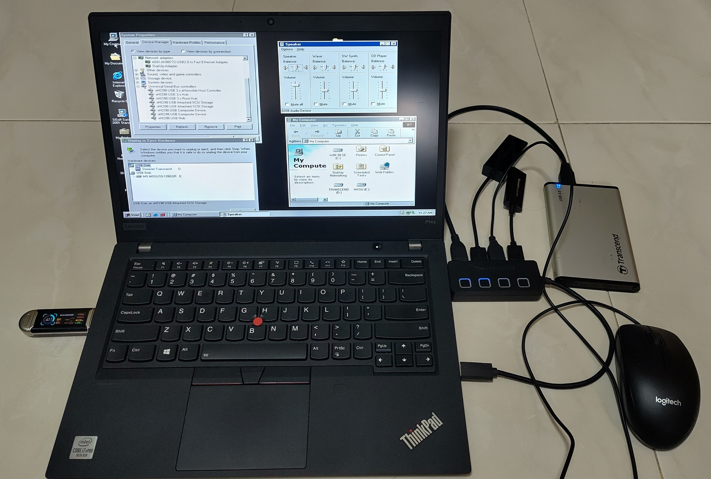
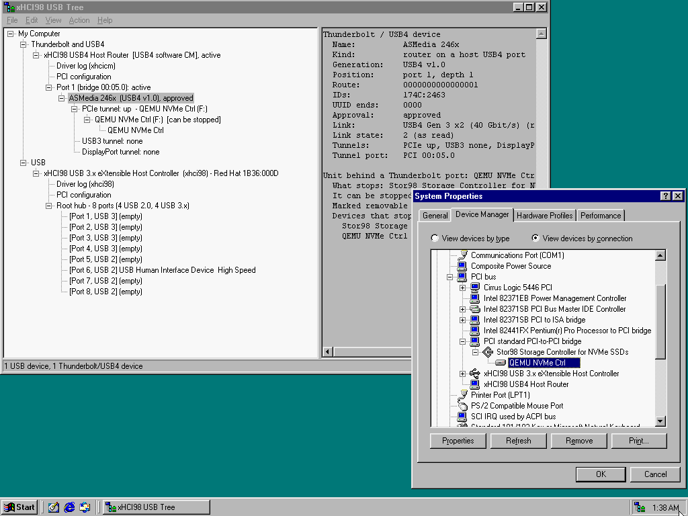
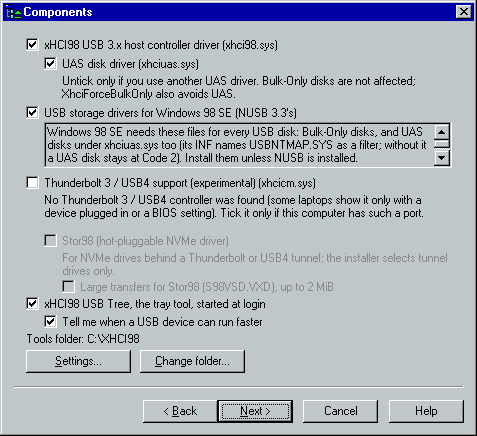

# xhci98

xHCI98 is a USB host controller driver (HCD) for xHCI (USB 3.x) controllers on Windows 98 SE, ME, 2000, XP (x86/x64), Vista (x86/x64) and 7 (x86/x64).

Experimental support for USB4 and Thunderbolt 3/4 is also included, on those systems and on Windows 8, 8.1 and 10 (x86/x64).

Supported:

- SuperSpeed devices and hubs:
  - USB 3.2 Gen 1, 5 Gbit/s
  - SuperSpeedPlus: USB 3.2 Gen 2 and Gen 1x2 (10 Gbit/s), and Gen 2x2 (20 Gbit/s)
- USB 2.0 and 1.1 (High, Full and Low Speed) devices and hubs
- UAS (USB Attached SCSI) storage, through a second driver, `xhciuas.sys`
- Thunderbolt 3 and USB4 docks and NVMe enclosures through a third driver, `xhcicm.sys`

It is built to Intel's xHCI specification and tested mainly on Intel machines. Other vendors' controllers carry no guarantee, though best effort has been made for the quirks of Fresco Logic, ASMedia, AMD, TI, Etron, VIA and some Intel controllers, even ones built to the xHCI 0.96 draft standard.

This is a solo human's project with AI assistance, so bugs are not unexpected. Please [report them](https://github.com/yeokm1/xhci98/issues/new/choose).

**Contents:** [Motivation](#motivation) - [SuperSpeed and UAS](#superspeed-and-uas) - [Thunderbolt 3 and USB4](#thunderbolt-3-and-usb4) - [The xHCI98 USB Tree](#the-xhci98-usb-tree) - [Benchmarking a disk](#benchmarking-a-disk) - [Installation Steps](#installation-steps) ([Downloads](#downloads), [SETUP.EXE](#install-with-setupexe), [by hand](#install-by-hand)) - [Tuning](#tuning) - [What is tested](#what-is-tested-and-what-is-not) - [The package](#the-package) - [Reporting a bug](#reporting-a-bug) - [Known limitations](#known-limitationsissues) - [Building](#toolchain-and-building) - [Repository Layout](#repository-layout) - [Documentation](#documentation) - [AI usage](#ai-usage) - [References](#references) - [Licensing](#licensing-and-provenance)



My 2020 ThinkPad P14s Gen 1 on Windows 98 SE with a USB 3.0 hub, two UAS drives, USB Ethernet, USB Audio and a mouse. All run on the xHCI controller, the drives at SuperSpeed.


Windows 7 with an ORICO USB4 NVMe enclosure on the Thunderbolt 3 port, through `xhcicm.sys` and [Stor98](src/stor98/): CrystalDiskMark sequential 1151 MB/s read, 1013 MB/s write.


The same enclosure on Windows 98 SE: about 210 MB/s read and 256 MB/s write, limited by Windows 98's own storage stack. With `S98VSD.VXD`, 2 MiB reads reach about 1120 MB/s and writes about 880 MB/s.



The xHCI98 USB Tree and Device Manager on Windows 98 SE, with an ASMedia USB4 NVMe enclosure on a USB4 host. Emulated hardware in QEMU.

- Video by [Omores](https://www.youtube.com/@O_mores) featuring this driver in its earlier USB 2.0 days:

  [](https://www.youtube.com/watch?v=7SOyvvC7P4E)

- My demo video: https://www.youtube.com/watch?v=AU77f9CSbYc
- Blog post xHCI98v1: https://yeokhengmeng.com/2026/08/xhci98-usb-host-driver/
- Blog post xHCI98v2 v3: https://yeokhengmeng.com/2026/10/xhci98-usb3-usb4/


## Motivation

PCs from the mid-2010s onwards have xHCI-only USB chipsets. Windows 98 shipped with USB 1.1 (UHCI/OHCI) drivers and gained USB 2.0 (EHCI) through NUSB's back-ported stack; Windows 2000 gained EHCI in SP4. Windows 7 has no USB 3 stack of its own either.

Without xHCI support, even keyboards, mice and flash drives need the BIOS's legacy support, cannot be hotplugged, and devices such as Ethernet and audio do not work at all. This project fills that gap.

## SuperSpeed and UAS


The P14s Gen 1 under Windows 98 SE with NUSB: the MSSU10-128GSR flash drive at SuperSpeed through `xhciuas.sys`. ATTO Disk Benchmark (Direct I/O) gives about 201 to 215 MB/s write and 196 to 221 MB/s read from 512 KB transfers upward.

- A UAS-capable drive gets UAS; anything else gets Windows' own `usbstor.sys` (Bulk-Only), at whatever speed it connects. A drive that offers both can be forced to Bulk-Only (`XhciForceBulkOnly`, see [Tuning](#tuning)).
- Device Manager and other Windows tools on these systems may show a SuperSpeed device as High Speed at most: the interface they read predates SuperSpeed.

## Thunderbolt 3 and USB4

`xhcicm.sys` brings Thunderbolt 3 and USB4 docks, enclosures and NVMe cases to these systems. Devices inside them (an NVMe drive, a dock's USB controller or network adapter) appear in Device Manager within seconds of the plug, with no Refresh, and leave on unplug. A device the BIOS connected at power-on is kept as it is.

- Intel Thunderbolt 2 and 3 controllers, and USB4-generation Intel ones while their firmware runs its own connection manager: the driver approves each device the firmware announces.
- USB4 hosts whose firmware has no connection manager (AMD, ASMedia ASM4242 on AM5 X870 boards, Intel Lunar Lake and later, Barlow Ridge): the driver is the connection manager and builds the tunnels.

Device Manager names each controller by its generation, then its maker and product: Thunderbolt 2 and Thunderbolt 3 (TB2, TB3) controllers, and USB4 Routers (the USB4 host router).

| Controller | PCI ids (`8086:` unless named) | In Device Manager |
|---|---|---|
| Falcon Ridge (Thunderbolt 2) | `156A`, `156C` | xHCI98 TB2 Controller (Intel Falcon Ridge) |
| Alpine Ridge (Thunderbolt 3) | `15BF`, `1575`, `1577`, `15D2`, `15D9` | xHCI98 TB3 Controller (Intel Alpine Ridge) |
| Titan Ridge (Thunderbolt 3) | `15E8`, `15EB` | xHCI98 TB3 Controller (Intel Titan Ridge) |
| Ice Lake | `8A0D`, `8A17` | xHCI98 TB3 Controller (Intel Ice Lake) |
| Maple Ridge | `1134`, `1137` | xHCI98 USB4 Router (Intel Maple Ridge) |
| Tiger Lake, Alder Lake, Raptor Lake, Meteor Lake | `9A1B`, `9A1D`, `9A1F`, `9A21`; `463E`, `466D`; `A73E`, `A76D`; `7EB2`, `7EC2`, `7EC3` | xHCI98 USB4 Router (Intel Tiger Lake), (Intel Alder Lake), (Intel Raptor Lake), (Intel Meteor Lake) |
| Lunar Lake, Panther Lake, Wildcat Lake | `A833`, `A834`; `E333`, `E334`, `E433`, `E434`; `4D33` | xHCI98 USB4 Router (Intel Lunar Lake), (Intel Panther Lake), (Intel Wildcat Lake) |
| Barlow Ridge | `5781`, `5784` | xHCI98 USB4 Router (Intel Barlow Ridge) |
| AMD Pink Sardine | `1022:1668`, `1022:1669` | xHCI98 USB4 Router (AMD Pink Sardine) |
| ASMedia and any other USB4 host | PCI class `0C0340` | xHCI98 USB4 Router |

### Before you start: 64-bit Windows

On Vista x64 to 10 x64, **test-signing mode must stay on for as long as the Thunderbolt 3 / USB4 support is installed**, even with nothing plugged in. Windows loads that driver at boot; without test-signing, 8, 8.1 and 10 stop in Automatic Repair and 7 x64 silently rolls the install back. A feature update, turning Secure Boot on or a boot repair can turn test-signing off. See [test-signing mode](#64-bit-vista-to-10-test-signing-mode).

### Before you start: the BIOS

- Boot in legacy (CSM) mode, as for every system here.
- **Thunderbolt BIOS Assist off.** With it on, the BIOS switches the controller off when nothing is attached at power-on, and the driver cannot switch it back on (on the P14s Gen 1 the controller disappears altogether).
- **Security level User Authorization or No Security.** Secure Connect, DisplayPort-only and USB-only are not supported.
- Pre-boot support (boot from Thunderbolt) may be on or off. When on, a device attached at power-on keeps working under the driver.

### Approving and removing

- **Names:** on Windows 2000 to 7 the controller's PCI ports show as "xHCI98 Thunderbolt PCI Bridge" or "xHCI98 USB4 PCI Bridge" (Windows' own bridge driver with this package's filter).
- **Approval:** by default (`XhciCmApprove` `1`) every device plugged in is approved at once. **A device with a PCI Express tunnel can read and write all of the machine's memory**, and these systems cannot stop it. Where untrusted people can reach the port, set `XhciCmApprove` to `0`: only devices the BIOS connected at power-on then work.

**Removing a device safely.** Close its open files first, then:

| Windows | How |
|---|---|
| 2000 | Stop it in "Unplug or Eject Hardware", then unplug. Without the stop, Windows 2000 shows "Unsafe Removal of Device". |
| XP, Vista, 7 | Stop it in "Safely Remove Hardware", then unplug. |
| 98 SE, ME | No such dialog lists them (ME's "Unplug or Eject Hardware", and NUSB 3.3's on 98 SE, list USB storage only): use the [xHCI98 USB Tree](#the-xhci98-usb-tree) or `INSTALL /eject`. Until you unplug, Device Manager's Refresh can start the device again. |

- A **dock** is listed under a generic PCI bridge name; stopping it stops everything in the dock.
- A **device missing from Windows' list** (its first plug, or after a disable and enable or a driver update): stop it in the USB Tree run as an administrator. Otherwise close every program using it, unplug it and plug it in again; Windows lists it from then on.
- For scripts: `INSTALL /devices` and `INSTALL /eject` (`tools\xhciinst\readme.txt`).

### NVMe drives

An NVMe drive in an enclosure needs an NVMe driver. **[Stor98](src/stor98/)**, shipped with this package, is that driver where Windows has none, or where Windows' own one handles an unplug badly. `xhcicm.sys` runs the tunnel; Stor98 runs the drive.

| Windows | Driver of a tunnelled NVMe drive | Why |
|---|---|---|
| 98 SE, ME, 2000, XP, Vista, 8 | Stor98 | no NVMe driver of its own |
| 7 | Stor98 | its `stornvme` comes only with update KB2990941, untested behind a tunnel |
| 8.1 | Stor98 (internal drives keep `stornvme`) | its `stornvme` hangs a write for good on an unplug without Safely Remove |
| 10 | Windows' own `stornvme`; Stor98 is opt-in | `stornvme` handles an unplug cleanly |

Use Safely Remove before unplugging a drive, on every system.

**Stor98 is only for NVMe drives behind a Thunderbolt or USB4 port, not internal ones.** `SETUP.EXE` puts it only on tunnel drives. On 2000 to 7 Windows may offer it for an internal NVMe drive with no driver: decline. On Vista x64, 7 x64 and 8, once the test certificate is trusted, Windows may put it on such a drive without asking; the uninstall then leaves it on that drive.

- `SETUP.EXE` installs Stor98 with the Thunderbolt 3 / USB4 support (its box, ticked with it) and updates an earlier Stor98. By hand: Update Driver on the drive's NVMe controller -> Have Disk -> `release-x86\` or `release-x64\`.
- On 98 SE and ME, `S98VSD.VXD` lets reads and writes of up to 2 MiB reach Stor98 whole, for much faster transfers. `SETUP.EXE` installs it with Stor98.
- Stor98's settings and limits: `stor98-readme.txt` beside it, and [the release notes](docs/using/release-notes.md#nvme-drives-behind-thunderbolt-or-usb4-new-in-3000).

### Things to know

- Before standby or hibernation, stop and unplug every Thunderbolt or USB4 device. Standby with one attached, or with an Ice Lake or later controller, is not supported.
- 98 SE and ME: a device plugged in after the start needs an interrupt from the BIOS (the P14s Gen 1 gives one). If it stays at Code 29, attach it at power-on with pre-boot support on.
- 98 SE and ME: the Thunderbolt driver stays loaded until a restart, so a disable, update or removal takes effect after one.
- If the platform switches a USB4 controller off behind Windows' back, disable and enable the controller, or restart.
- Settings: [Tuning](#tuning). Detail: the release notes' [Thunderbolt and USB4 sections](docs/using/release-notes.md#what-3000-adds) and [known limitations](docs/using/release-notes.md#thunderbolt-and-usb4-known-limitations).

## The xHCI98 USB Tree

`XHCITR.EXE` (`XHCITR64.EXE` on 64-bit Windows) shows every USB and Thunderbolt/USB4 controller and device. It needs no administrator rights. The install starts it at login as a notification-area icon (untick Start at login in its menus to stop that); it is also in `tools\xhcitr\`.

- **Safely Remove:** left-click the icon, pick the device and unplug when told. Works for USB storage on 98 SE and ME too.
- **Notices:** a "can run faster" balloon for a device on a slower port or behind a slower hub, a red icon while something needs you, and a warning after a Thunderbolt or USB4 device is removed unexpectedly.
- **Details:** each item's speed, port, IDs, driver, Device Manager status, resources and PCI configuration. File > Save Report writes it all to a text file for a bug report.
- **Driver log:** each controller has a "Driver log" item, included in Save Report. View > Logging level... sets either driver's level (default 2, `0` for off; takes effect after a restart).
- **Snapshot:** Save Report ends with the driver's snapshot (its device report and decoded state). File > Save Snapshot..., `XHCITR /snapshot`, `/dump` and `/probe` write the snapshot's files themselves, for when a maintainer asks for them.

Details: [the release notes' USB Tree section](docs/using/release-notes.md#the-xhci98-usb-tree).

## Benchmarking a disk

To benchmark a disk, use CrystalDiskMark or ATTO Disk Benchmark (suggestions, not part of this package). XHCIPERF stays a developer diagnostic in the source tree (`xhciperf\`), not shipped.

## Installation Steps

### Downloads

Each release has three zips. Each holds everything in the one before it, so pick one:

| Download | What it holds |
|---|---|
| `xhci98-<version>.zip` | The xHCI98 drivers (USB 3, UAS, Thunderbolt 3 / USB4), Stor98, the installer and the tools. Also NUSB 3.3's seven Windows 98 SE storage files in `USBDRV\NUSB33\`, which the installer offers on 98 SE when NUSB is not installed (an installed NUSB is kept). |
| `xhci98-<version>-free.zip` | Adds the free USB class drivers (audio, webcam, Ethernet and more) from [usb-wdm-free](https://github.com/yeokm1/usb-wdm-free) in `USBDRV\FREE\`. Experimental: they may not work with every device and can make Windows unstable. It includes the CamCheck webcam preview tool in `USBDRV\FREE\tools\camcheck\`. |
| `xhci98-<version>-nonfree.zip` | Adds a pack of other manufacturers' USB drivers from [usb-wdm-nonfree](https://github.com/yeokm1/usb-wdm-nonfree) in `USBDRV\NONFREE\`, not this project's work. |

Nothing from `USBDRV\` is installed unless you tick it on the installer's Other USB drivers page. On Windows 98 SE and ME the free and non-free drivers are copied only: when the hardware wizard asks for a driver, point it at the package's folder, `USBDRV\FREE\<class>\<package>\<folder>` (or `USBDRV\NONFREE\...`) in the install directory.

### Requirements

| Windows | What to install first |
|---|---|
| 98 SE | [NUSB 3.3 or 3.6](https://www.philscomputerlab.com/windows-98-usb-storage-driver.html) for USB storage, UAS included. Without it HID and audio work but storage has no driver. [SweetLow's stack](http://sweetlow.orgfree.com/download/usb20_win9x.zip) also works (right-click its root `USB2.INF`, Install) but has no storage half: a stick shows Code 28 and a UAS drive Code 2 until NUSB's storage files are present. Reboot if asked. |
| ME | Nothing; a stock ME works, as does [SweetLow's stack](http://sweetlow.orgfree.com/download/usb20_win9x.zip) if already there. Plug an ordinary USB stick in once, so ME copies its storage drivers, before a UAS drive is recognised. |
| 2000 SP4, XP SP3 | Nothing. |
| XP x64 SP2, Vista SP2, 7 SP1 (x86/x64) | Nothing. **Vista x64 and 7 x64** need [test-signing mode](#64-bit-vista-to-10-test-signing-mode) (or F8 at every boot). |
| 8, 8.1, 10 (x86/x64) | **Secure Boot off** in the firmware setup; the x64 editions also need [test-signing mode](#64-bit-vista-to-10-test-signing-mode). Windows' own USB 3 driver stays unless you tick the USB drivers. |

- **The eject icon on 98 SE** comes only with NUSB 3.3's own setup, not with the seven storage files in this download. It lists USB sticks and UAS disks, never a Thunderbolt or USB4 drive: use the [xHCI98 USB Tree](#the-xhci98-usb-tree) or `INSTALL /eject` for those.
- 98 SE storage of any kind needs NUSB's mass-storage files ([details](docs/using/release-notes.md#windows-98-se-and-me-the-stock-install-and-storage)).
- On an xHCI-only 98 SE or ME machine, **have the Windows CD (or its files) at hand**: Windows may ask for files.

### Check the machine first (optional, recommended)

Boot real DOS (not a DOS box inside Windows) and run `XHCIQUAL` from `TOOLS\XHCIQUAL\`. It says whether the driver can work on the machine before you install anything. A controller with no legacy interrupt pin is not refused: the driver polls it, or uses a message-signalled interrupt on Vista and 7, and `XHCIQUAL` reports `QUALIFIED WITH CAVEATS`.


The read-only quick scan answers in one line. The `xhci` run exercises the controller (handoff, reset, DMA, interrupt, port resets) and ends with a verdict:


XHCIQUAL demo video: https://www.youtube.com/watch?v=Tv6blmBS6Do

### Install with SETUP.EXE

You can also install by hand from Device Manager ([Install by hand](#install-by-hand)).

1. Unzip the whole package.
2. Double-click `SETUP.EXE` in its top directory (on 2000 and XP as an administrator; on Vista and later answer Yes when Windows asks).
3. Go through the pages: Welcome, Components, Other USB drivers and Summary. The driver's options are under Settings; the tools go to `C:\XHCI98`. Nothing changes until you click Install.
4. Answer Windows' unsigned-driver questions. If the Finish page lists steps left for you (a Found New Hardware window, for instance), do them and run `SETUP.EXE` again. Restart if it offers.



The installer's Components page on Windows 98 SE.

What it does:

- **Windows 2000 to 7:** installs or updates the driver of every device present and stages the package for devices plugged in later.
- **Windows 98 SE and ME:** copies the package to the install directory, adds it to the hardware wizard's search path and installs each device through Windows' own installer.
- **Thunderbolt 3 / USB4 support (experimental):** on 2000 to 7, unticked unless you tick it; the line under it says whether a controller was found. Some laptops show the controller only with a device plugged in, so tick it if yours has the port. It ticks Stor98 too (except on Windows 10). On 2000 to 7 it also puts the filter on the controller's PCI ports so Windows sees devices plugged in later (on 2000, after one restart). Untick the USB drivers to install it alone, for a machine whose USB 3 runs another driver. If the Summary page says "Thunderbolt 3 and USB4 will be turned off (XhciCmMode 0)", go back and check its settings.
- **Windows 8, 8.1 and 10:** only the Thunderbolt 3 / USB4 support by default; Windows' own USB 3 driver keeps the USB controllers unless you tick the USB drivers. Secure Boot must be off, and on x64 it installs only in test-signing mode ([Before you start](#before-you-start-64-bit-windows)).

To uninstall, use Remove in Add/Remove Programs (Programs and Features on Vista and later). Every run writes `XHCIINST.LOG` at the root of the system drive; attach it to a bug report about an install. For scripted installs, see `tools\xhciinst\readme.txt`.

Details: [the release notes' installer section](docs/using/release-notes.md#installing-updating-and-uninstalling-with-installbat-new-in-3000).

### Install by hand

1. Put the unzipped package where the machine can read it (floppy, CD, shared folder), and install the [prerequisites](#requirements). On a fresh 98 SE the order is NUSB, then xhci98, then the UAS disk.
2. In Device Manager, find the unrecognised xHCI controller (yellow mark, usually under "Other devices").
3. Properties -> Driver -> Update Driver -> Have Disk -> `release-x86\` or `release-x64\`. It installs as "xHCI98 USB 3 Controller" with "xHCI98 USB 3.x Root Hub" beneath (only `SETUP.EXE` adds the chipset to the name). 98 SE may ask for its CD. Restart if asked.
4. A Thunderbolt 3 or USB4 controller ("PCI System Peripheral" or "Base System Device") installs the same way. On 2000 to 7, then give each of its PCI ports the filter: Update Driver -> Have Disk -> `release-x86\nt\` (32-bit) or `release-x64\` (64-bit).
5. A UAS disk or an external hub asks for its driver when plugged in: give it the same directory. On XP every new hub brings the Found New Hardware wizard and the unsigned-driver warning (Continue Anyway).


The controller in Device Manager on the P14s Gen 1 under Windows 98 SE.

### 64-bit Vista to 10: test-signing mode

The 64-bit drivers are test-signed, so Vista x64 to 10 x64 run them in test-signing mode (or with F8, "Disable Driver Signature Enforcement", at every boot). On 8, 8.1 and 10, turn Secure Boot off in the firmware setup first. Then, once:

1. Open an elevated Command Prompt (Start, type `cmd`, right-click, Run as administrator).
2. Run `bcdedit /set testsigning on`. It stays on for every boot until turned off.
3. Restart. "Test Mode" shows on the desktop (bottom right on 7 and later, in the corners on Vista).
4. Install the driver. Windows still says it cannot verify the publisher: choose "Install this driver software anyway". The Driver tab then says "Not digitally signed". Both are expected.

- Check: `bcdedit /enum {current}` shows `testsigning Yes`.
- Turn off: `bcdedit /set testsigning off` and restart. The driver then needs F8 again, or the controller shows Code 39 (Vista) or Code 52 (7).
- **With BitLocker on the system drive, suspend it before changing the boot setting**, or the next boot asks for the recovery key.
- This is not Microsoft signing: the certificate is the project's own, which no Windows trusts by itself. F8 still works for one boot without test mode.

### Installing Windows 2000 or XP, or using the Recovery Console

For a machine whose keyboard or install medium is on the xHCI controller:

1. Copy the files of `release-x86\` (`release-x64\` for XP x64) to the root of a floppy.
2. **Windows 2000 only:** from the `I386` folder of your Windows 2000 CD, copy `USBD.SY_`, `HIDCLASS.SY_` and `HIDPARSE.SY_` to the floppy's root, unchanged (do not expand or rename). The package does not carry them.
3. Press F6 when text-mode Setup offers it, then S, and pick "xHCI98 USB 3.x Host Controller (32-bit Windows 2000/XP)" (the x64 entry on XP x64), or on Windows 2000 the second entry, "xHCI98 USB 3.x Host Controller (32-bit Windows 2000, files from CD)".

- **Windows 2000:** with a USB keyboard, mouse or stick used during Setup, the first entry leads to `STOP c000026c` at the first start; the second entry without the three files stops Setup asking for them in drive A: (F3 quits). Plug the USB keyboard and stick in before Setup starts.
- **XP and XP x64: have a PS/2 or built-in laptop keyboard at hand.** Later in Setup the USB keyboard does not work until a step that first asks about this unsigned driver.
- Pressing F6 needs the BIOS's own USB keyboard support.
- A USB floppy drive works for F6 only if it is one Setup knows: Mitsumi `03EE:6901`, Y-E Data `057B:0000` or TEAC `0644:0000` (VID:PID). No INF can add another; otherwise use a floppy drive on the floppy controller.
- A UAS-only disk is not usable until GUI-mode Setup; a flash stick, or a UAS disk that also offers Bulk-Only (most do), is.
- A USB drive present at the partition screen takes `C:`. Unplug the USB drives you do not need.
- **Recovery Console** (2000 and XP): the same floppy and F6, then R at the Welcome screen (on 2000, then C). The USB keyboard works throughout.

Details and limits: [the release notes' F6 section](docs/using/release-notes.md#installing-windows-2000-or-xp-or-using-the-recovery-console-the-f6-floppy).

### Upgrading the driver

Run `SETUP.EXE` (see [above](#install-with-setupexe)). By hand: Update Driver on the controller ("xHCI98 USB 3 Controller", or "xHCI98 USB 3.x eXtensible Host Controller" while an older version is installed), then on "xHCI98 USB 3.x Root Hub", pointed at `release-x86\` or `release-x64\`.

- **98 SE and ME:** restart afterwards, although Windows does not ask. The old driver runs until then.
- **2000:** use Have Disk (Update Driver -> "Display a list of the known drivers" -> Have Disk -> `release-x86\`) and pick the first model listed. Letting Windows search keeps the old driver.
- **XP, Vista and 7:** the new driver runs at once, after the unsigned-driver warning; 32-bit Vista and 7 ask for a restart. Vista and 7 do not take a build with the same `DriverVer` as the installed one.
- A device Windows finds again as new hardware loses its hidusbf setting. Set it again.
- **From `2.3.x` or earlier:** update the controller only; the hubs and composite devices then install by themselves. On 98 SE, XP and XP x64 keep a PS/2 or built-in keyboard and mouse at hand. See [From 2.3.x or earlier](docs/using/release-notes.md#from-23x-or-earlier).
- **`xhciuas.sys` at the same `DriverVer`:** use Have Disk on "xHCI98 USB Attached SCSI Storage"; letting Windows search keeps the cached INF.

## Tuning

Each value is a `DWORD` in a driver (software) key, and also in the machine-wide key `HKLM\System\CurrentControlSet\Services\USB`, which wins for every controller when the value is there ([tuning](docs/using/tuning.md#where-the-values-are-and-every-value)); restart Windows after a change (for `XhciCm*`, disabling and enabling the controller also works). The install writes most values (its Settings dialog, and "Advanced...") and an update keeps any you changed.

| Driver | Windows | Key (`NNNN` is the subkey whose `DriverDesc` names the controller) |
|---|---|---|
| `xhci98.sys` | 98 SE, ME | `HKLM\System\CurrentControlSet\Services\Class\USB\NNNN` |
| `xhci98.sys` | 2000 to 7 | `HKLM\SYSTEM\CurrentControlSet\Control\Class\{36FC9E60-C465-11CF-8056-444553540000}\NNNN` |
| `xhcicm.sys` | 98 SE, ME | `HKLM\System\CurrentControlSet\Services\Class\System\NNNN` |
| `xhcicm.sys` | 2000 to 7 | `HKLM\SYSTEM\CurrentControlSet\Control\Class\{4D36E97D-E325-11CE-BFC1-08002BE10318}\NNNN` |

| Value | What it does | Default |
|---|---|---|
| `XhciLogVerbosity` | The driver's log level, read by the USB Tree (`0` to `4`; `0` off) | `2` (fresh install; an update keeps the value there) |
| `XhciLogDebugView` | The log sent to DebugView as well | `0` |
| `XhciInterruptMode` | How events arrive: `0` automatic, `1` interrupt line, `2` polling, `3` message-signalled interrupt only | `0` |
| `XhciSelectiveSuspend` | `1` suspends idle devices when Windows asks | `0` |
| `XhciMaxTransferKB` | The largest UAS command, `64` to `2048` KiB | `1024` |
| `XhciForceBulkOnly` | `1` uses Bulk-Only instead of UAS | `0` (`1` if the value is absent) |
| `XhciIntelPortSwitch` | Intel 7/8/9-series port switchover: `1` on, `2` any Intel controller **at your own risk** (`tools\portsw\`) | `0` |
| `XhciCmMode` | Thunderbolt/USB4: `0` off, `1` automatic (`2` and `3` are at your own risk) | `1` |
| `XhciCmApprove` | `1` approves every device, `0` none (see [approval](#approving-and-removing)) | `1` |
| `XhciCmSafeEject` | `1` offers tunnelled devices for safe removal (98 SE and ME: in the USB Tree and `INSTALL /eject` only) | `1` |
| `XhciCmBridgeNumbering` | 98 SE and ME: `1` sets up PCI bridges behind a tunnel plugged in after start (else Code 29 until restart) | `1` |
| `XhciCmLogVerbosity` | The Thunderbolt driver's log level, read by the USB Tree (`0` to `4`) | `2` |
| `XhciCmLogDebugView` | The Thunderbolt driver's log sent to DebugView as well | `0` |

[docs/using/tuning.md](docs/using/tuning.md) has every value of both drivers, its range and its effect, including polling periods, interrupt moderation, controller-fault handling, the per-controller fixes, the Linux-derived controller quirks and the `XhciCm*` values; the release notes describe [the `XhciCm*` values](docs/using/release-notes.md#the-connection-managers-registry-values) in full.

## What is tested, and what is not

- Windows 98 SE and Windows 2000 SP4 are the primary targets.
- Real hardware: Windows 98 SE on the ThinkPad E460 and P14s Gen 1, and the Intel port switchover under Windows 98 SE on the Lenovo B490; Windows XP x64 and 7 x64 on the Dell Latitude E7250.
- Every other target, Windows 2000 included, has run in QEMU virtual machines only.
- The free USB class drivers a download may carry are tested in their own project: which of their tests used an emulated device, a real device through a virtual machine, or a real PC is in [usb-wdm-free's "Tested by the author"](https://github.com/yeokm1/usb-wdm-free#tested-by-the-author).
- Per-system detail: the release notes' [Targets and their standing](docs/using/release-notes.md#targets-and-their-standing). The test devices: [test-equipment.md](docs/contributing/test-equipment.md).

| Machine | Controller | Tested by |
|---|---|---|
| 2012 Lenovo B490 | Intel Ivy Bridge, Panther Point HM77 (7-series) PCH, with EHCI beside it. xHCI 1.0. | Me |
| 2015 Dell Latitude E7250 | Intel Broadwell-U, Wildcat Point-LP (9-series) PCH, with EHCI beside it. xHCI 1.0. | Me |
| 2016 ThinkPad E460 | Intel Skylake, Sunrise Point-LP (100-series) PCH. xHCI 1.0. | Me |
| 2018 HP EliteBook 850 G5 | Intel Sunrise Point-LP (`8086:9D2F`, the E460's controller), xHCI 1.0. | Community |
| 2020 ThinkPad P14s Gen 1 | Intel Comet Lake PCH-LP (400-series). xHCI 1.1. | Me |
| Omores' Intel and AMD desktops | H110, B360, B550, X570, X670 | [Omores](https://www.reddit.com/r/windows98/comments/1whzyoa/xhci98_windows_98_gets_usb_3x_controller_support/) (1.x.x.x) |

## The package

Install from `release-x86\` (32-bit Windows) or `release-x64\` (64-bit Windows).

| Path | Contents |
|---|---|
| `release-x86\`, `release-x64\` | The drivers to install (below) |
| `debug-x86\`, `debug-x64\` | The same drivers built for troubleshooting; install only if asked |
| `SETUP.EXE` | The installer: double-click it to install or update |
| `USBDRV\` | Other USB drivers the download carries: `NUSB33\`, plus `FREE\` in the `-free` download, and `FREE\` and `NONFREE\` in the `-nonfree` one ([Downloads](#downloads)) |
| `INSTALL.BAT`, `tools\xhciinst\` | For command-line and scripted installs (`tools\xhciinst\readme.txt` is the reference), and the programs both run (`XHCIWIZ.EXE`, `XHCIWZ64.EXE`, `XHCIINST.EXE`, `XHCIIN64.EXE`) |
| `tools\xhcitr\` | The xHCI98 USB Tree, also the driver's log and snapshot reader |
| `tools\xhciqual\` | DOS: `XHCIQUAL.EXE` and `QUALREP.BAT` |
| `tools\portsw\` | `portsw.vbs`, `portsw-on.bat`, `portsw-off.bat`: the Intel port switchover |
| `tools\silent\` | 98 SE and ME: the silent install's list and switch |
| `tools\xhcicln\` | `XHCICLN.EXE`, `XHCICL64.EXE`: optionally lists, and on 2000 to 7 removes, old `XHCI98\` entries left by an update from `2.3.x` or earlier; nothing needs it |
| `readme.txt` | The release notes in plain text |

Each driver directory holds:

- `xhci98.sys`/`.inf` (controller), `xhciuas.sys`/`.inf` (UAS storage), `xhcicm.sys`/`.inf` (Thunderbolt and USB4; its PCI-port filter for 2000 to 7, `xhcicmf.inf`, in `nt\` in the x86 directories and beside them in the x64 ones)
- `xhcihlpr.sys` (32-bit only): a helper 32-bit 2000, XP, Vista and 7 use for a finer timer while polling and, on Vista and 7, a message-signalled interrupt. 98 SE and ME ignore it.
- `txtsetup.oem`: for F6 during Windows 2000 or XP Setup
- `xhci98-test.cer` (64-bit only): the public half of the x64 drivers' test certificate; no need to import it
- `*.cat` (64-bit only): a test-signed catalog for each driver, which 64-bit 8, 8.1 and 10 need
- `stor98*` files (`release-` only): the bundled NVMe driver (see [NVMe drives](#nvme-drives)), and `S98VSD.VXD` beside them in `release-x86\` for 98 SE and ME

## Reporting a bug

Bugs in the free USB class drivers go to [usb-wdm-free's issues](https://github.com/yeokm1/usb-wdm-free/issues). The non-free drivers are from their manufacturers, as released, unchanged by this project. Everything else: open a [bug report](https://github.com/yeokm1/xhci98/issues/new/choose) and attach:

- **The DOS report:** run `QUALREP.BAT` from real DOS in `TOOLS\XHCIQUAL\` and attach the `.LOG` it names (read-only). If a maintainer asks for the full run, `XHCIQUAL --no-page --log FULL.LOG` **resets the controller and its ports**: use a PS/2 keyboard, and do not write the log to a drive on that controller.
- **The driver's report:** make the problem happen, then in the xHCI98 USB Tree use File > Save Report (or `XHCITR /report <file>`) and attach the `.TXT`. It needs the logging level at 2 or more (the default; View > Logging level...).
- **An install problem:** `XHCIINST.LOG` from the root of the system drive.

## Known limitations/issues

The release notes' [Known limitations](docs/using/release-notes.md#known-limitations), [Thunderbolt and USB4 limitations](docs/using/release-notes.md#thunderbolt-and-usb4-known-limitations) and [Untested ground](docs/using/release-notes.md#untested-ground) have the full lists. The ones most likely to matter:

- **Windows 98 SE and ME**
  - Stock Windows 98 SE has no USB storage driver without NUSB. HID and audio still work.
  - The first time an NVMe enclosure is plugged in, Windows' wizard may ask for the "Stor98 Storage Controller Disk". Point it at `C:\XHCI98`.
  - Windows ME: do not unplug a device while Windows is installing it. Shut Down can hang with a USB disk not opened since start; open it once (a `dir` is enough) or remove it first. (Both happen on Microsoft's own USB stack too.)
  - Windows ME: a UAS drive plugged in before any ordinary stick shows Code 2. Plug in a stick once, then replug the UAS drive.
  - The free and non-free drivers are copied, not staged: point the hardware wizard at the package's folder under `C:\XHCI98\USBDRV\`.
  - Windows 98 SE: the first USB audio device plugged in after a boot (a webcam with a microphone included) can freeze Windows, with Windows' own drivers too. Plug it in before switching on and leave it plugged in; for a webcam whose microphone you do not need, usb-wdm-free's `NOAUD98.INF` avoids it.
- **Windows 2000**
  - A mounted USB drive can come back at Code 31 after a controller recovery or hibernation. Replug it, or disable and enable it.
- **Windows XP**
  - Installing XP from the F6 floppy needs a PS/2 or built-in keyboard to answer GUI-mode Setup's unsigned-driver question. Windows 2000 does not ask.
- **Vista x64 and 7 x64**
  - Test-signing mode or F8 is needed at every start; otherwise the controller sits at Code 39 (Vista) or Code 52 (7).
- **Windows 8, 8.1 and 10**
  - Secure Boot must be off, and the x64 editions need test-signing mode.
  - The uninstall may need a restart and a second run to finish on 8.1 and 10.
- **Thunderbolt and USB4**
  - Standby and hibernation with a device attached are not supported. Stop and unplug the device first.
  - A drive attached during the install or update appears in Safely Remove Hardware only after a restart or a replug.
  - Windows 2000 to 7 with a USB4 host: ejecting a dock, or an enclosure with its own PCIe switch, stops it safely, but its connection stays up until you physically disconnect it.
  - A dual-mode NVMe enclosure (USB4 or Thunderbolt, and USB) may come up as a USB (UAS) disk instead. Unplug it and plug it in again to get the Thunderbolt or USB4 connection.
- **Controllers**
  - Disabling a controller the driver had to close off hangs (very rare). Restart instead.
  - Intel 7-series (`8086:1E31`): too many periodic devices at once (audio, mice) may lose data instead of being refused.
- **Untested**
  - SuperSpeedPlus (USB 3.2 Gen 2, Gen 1x2 and Gen 2x2): supported, but checked only in an emulator, not on real hardware.
  - SuperSpeed isochronous, polling above 1000 Hz, controllers below xHCI 1.0 (accepted by default; `XhciAccept096` `0` refuses them), and the Linux-derived controller quirks.

## Toolchain and building

The drivers are C89 (no C++ or CRT), built on Windows 11 x64. The toolchain unpacks inside the repository (`tools/`, git-ignored), installs nothing to `C:\`, and every script finds it relative to itself.

1. Download into `tools\` under these exact names:

   | File | Source |
   |---|---|
   | `tools\MSVC600.zip` | MSVC 6.0 - [itsmattkc/MSVC600](https://github.com/itsmattkc/MSVC600) |
   | `tools\WIN2KDDK.EXE` | Windows 2000 DDK - [KunYi/WDK_DDKArchive](https://github.com/KunYi/WDK_DDKArchive/releases/tag/Win2K_DDK) |

   The 64-bit build (and the 32-bit `xhcihlpr.sys`) also needs WDK 7.1 (7600.16385.1) unpacked to `tools\WinDDK71`.

2. Unpack them in place:

   ```powershell
   powershell -ExecutionPolicy Bypass -File scripts\setup-msvc6.ps1        # -> tools\MSVC600
   powershell -ExecutionPolicy Bypass -File scripts\install-w2kddk-cabs.ps1 # -> tools\ntddk
   ```

3. Build. `both` (default) is the shipping `release` and `debug` flavours; `all` adds the emulator-only `qemu` flavour, which is never published. `-amd64` builds the separate 64-bit binaries. Every build runs the gates' self-tests, the host unit tests and the INF, import and charset gates, and stops on any failure.

   ```
   scripts\build-driver.cmd both
   scripts\build-driver.cmd both -amd64
   ```

   The same runs build and gate Stor98, the bundled NVMe driver, from `src\stor98` (it also needs the Windows 98 DDK's `SCSI.H` and `SRB.H` in `tools\w98ddk\inc`; [src/stor98/docs/BUILD.md](src/stor98/docs/BUILD.md)); `scripts\build-all.cmd` runs both architectures at once.

4. The tools build with their own `build.cmd` in `xhciqual\` (needs [Open Watcom 2.0](https://github.com/open-watcom/open-watcom-v2/releases) at `C:\WATCOM`), `xhcicln\`, `xhciinst\` and `xhcitr\`.
5. Install media: `scripts\package\make-package.ps1` (to `out\`); a release cut: `scripts\package\make-release.ps1`. Never hand-copy a `.sys` without its INF.
6. Test in QEMU with `qemu-xhci` (Win98 SE, Win2000 SP4 and an SMP Win2000 guest; `usb-storage` and `usb-uas` for SuperSpeed and UAS).

The version lives in [src/xhci_version.h](src/xhci_version.h). [build-and-test.md](docs/contributing/build-and-test.md) has the full procedure (VMs, gates, versioning, packaging), and [source-files.md](docs/contributing/source-files.md) says what each source file is.

## Repository Layout

```
src/            xhci98.sys (C), its two INFs and DDK build files
  uas/          xhciuas.sys, the UAS class driver
  cm/           xhcicm.sys, the Thunderbolt and USB4 driver
  stor98/       Stor98, the bundled NVMe driver (BSD-3-Clause)
test/           Host-side unit tests (test\run-host-tests.cmd)
scripts/        Build wrapper, setup helpers, gates, vm-matrix/
xhciqual/       DOS hardware-qualification tool (Open Watcom)
xhcicln/        Optional cleanup tool for old XHCI98\ devnodes
xhciinst/       Install/update/uninstall tool and INSTALL.BAT
xhcitr/         The xHCI98 USB Tree
docs/           Documentation, indexed by docs/README.md
releases/       Every release cut, one directory per version
images/         Pictures used by this README
.github/        Issue forms
AGENTS.md       Maintainer and AI agent guide
tools/ external/ vm/ out/   Toolchain, reference mirrors, guests, staged media (git-ignored)
```

## Documentation

Everything is under [docs/](docs/), indexed by [docs/README.md](docs/README.md). Start with:

- Users: [Release notes](docs/using/release-notes.md), [Tuning](docs/using/tuning.md), [Release acceptance test](docs/using/release-acceptance-test.md), [Release history](releases/history.md)
- Contributors: [AGENTS.md](AGENTS.md) (the orientation), [Build and test](docs/contributing/build-and-test.md), the roadmaps [for 2.0.0.0 onward](docs/contributing/roadmap-hcd.md) and [for 3.0.0.0 onward](docs/contributing/roadmap-usb4.md), [Design records](docs/contributing/design/README.md) (the HCD is [13](docs/contributing/design/13-superspeed-hcd.md); Thunderbolt and USB4 are [21](docs/contributing/design/21-thunderbolt3-icm-client.md) and [22](docs/contributing/design/22-usb4-software-connection-manager.md)), [Source files](docs/contributing/source-files.md), [Failure diagnosis](docs/contributing/failure-diagnosis.md) and [lessons](docs/contributing/lessons.md), [Test equipment](docs/contributing/test-equipment.md), [Legal and provenance record](docs/contributing/legal-provenance.md)
- Hardware and Windows: [xHCI programming](docs/usb-xhci-info/xhci-programming.md), [xHCI data structures](docs/usb-xhci-info/xhci-data-structures.md), [Windows 98/2000 WDM constraints](docs/usb-xhci-info/win98-wdm.md), and the 1.x miniport's [USBPORT interface](docs/usb-xhci-info/usbport-miniport-interface.md) and [ABI](docs/usb-xhci-info/usbport-miniport-abi.md)

## AI usage

This project was developed with substantial help from AI coding agents:

- Claude Fable 5.1 for planning
- Claude Opus 5.5 for coding
- Codex GPT 6 Astra as an adversarial reviewer

The agents wrote and revised code, tests and documentation under the guidance in [AGENTS.md](AGENTS.md).

Kheng Meng directed the work, ran the hardware validation on real machines and reviewed what went in.

## References

- [xHCI specification](https://www.intel.com/content/www/us/en/content-details/868295/extensible-host-controller-interface-for-universal-serial-bus-xhci-requirements-specification-r1-2c.html) (Intel), citations verified against revision 1.2c
- [USB 3.2 specification](https://www.usb.org/document-library/usb-32-revision-11-june-2022) (USB-IF), revision 1.1 (June 2022) with its ECNs, cited as `USB 3.2 p.N`
- [USB-IF xHCI backwards compatibility testing](https://www.usb.org/sites/default/files/xHCI_Backwards_Compatibility_Testing_v1_7.pdf) (v1.7)
- [How does USB stack enumerate a device?](https://techcommunity.microsoft.com/blog/microsoftusbblog/how-does-usb-stack-enumerate-a-device/270685) (Microsoft USB blog) - the hub driver's enumeration steps and timeouts, which the first-enumeration wait's defaults follow
- [ReactOS usbport](https://github.com/reactos/reactos/tree/master/drivers/usb/usbport) - the `usbport.sys` miniport interface of the 1.x driver (undocumented by Microsoft)
- [Linux xhci-pci.c](https://github.com/torvalds/linux/blob/master/drivers/usb/host/xhci-pci.c) - controller quirk table
- [Haiku XHCI driver](https://github.com/haiku/haiku/blob/master/src/add-ons/kernel/busses/usb/xhci.cpp) and [FreeBSD xhci.c](https://github.com/freebsd/freebsd-src/blob/main/sys/dev/usb/controller/xhci.c) - second opinions on hardware details

None of these PDFs is tracked here; fetch your own into the git-ignored `docs/references/` ([docs/references/README.md](docs/references/README.md) has versions and SHA-256 sums). Source mirrors go in `external/` ([external/README.md](external/README.md)).

## Licensing and provenance

This project's own source is licensed under the GNU General Public License, version 2 ([LICENSE](LICENSE)), `GPL-2.0-only`.

Apart from Stor98's earlier released builds under `src/stor98/releases/` (below), the repository tracks no third-party binary on its own, although the tool executables it tracks under `releases/` carry statically linked third-party runtimes:

- `xhci98.sys` and `xhciuas.sys` link no runtime or extender. The 32-bit builds link no third-party object either; the 64-bit builds, linked by WDK 7.1, carry that kit's `/GS` stack-cookie handler (`__security_check_cookie` / `__report_gsfailure`), which nothing in this project's source calls.
- Some files of `xhcicm.sys`'s source, under `src/cm/`, are adapted from the `usb4-emu` project (some lifted from its `tools/usb4cm` under its earlier MIT licence) and from Linux's `drivers/thunderbolt`, and keep their copyright lines and licence notices. The [legal and provenance record](docs/contributing/legal-provenance.md), section 2a, lists each file.
- `XHCIQUAL.EXE` embeds the Open Watcom runtime and the DOS/32A extender.
- `XHCISNAP.EXE`, in the releases up to `3.0.0.0`, embeds the MSVC 6.0 runtime.
- `XHCICLN.EXE`, `XHCIINST.EXE` and `XHCITR.EXE` embed the MSVC 6.0 runtime; `XHCICL64.EXE`, `XHCIIN64.EXE` and `XHCITR64.EXE` the WDK 7.1 one. None of them contains or runs a Microsoft setup program such as devcon: they call the setup routines of the Windows they run on.

Each tool ships with a `NOTICE.TXT` recording it, and the `LICENSE` scope note says that those runtimes carry their own terms and are outside the grant. Neither quotes the terms themselves.

The release download's `release-x86\` and `release-x64\` carry Stor98, built from this repository's `src/stor98/` with the drivers, under its own licence; its `LICENSE` and `NOTICE` ship beside it as `stor98-LICENSE.txt` and `stor98-NOTICE.txt`. Since 2026-10-19 Stor98 itself - its source and its earlier released builds - is in this repository as [src/stor98/](src/stor98/), under its own licence ([src/stor98/LICENSE](src/stor98/LICENSE), BSD-3-Clause) with its [NOTICE](src/stor98/NOTICE) recording where its code came from.

This repository carries no Microsoft file. `usbd.sys` and `usbui.dll` are the OS's own, copied by Windows Setup from its own install source. The release download may carry one set: NUSB 3.3's seven Windows 98 SE storage files (Microsoft's, apart from `USBU2A.SYS`), unmodified, from the separate driver-pack repository `usb-wdm-nonfree`, in a folder of their own with that pack's `NOTICE.md`, never committed here. They are not this project's work and no licence to redistribute them has been established; a download built without them says so in its `readme.txt`. On Windows 98 SE, `xhciuas.inf` names `USBNTMAP.SYS` as a filter on the UAS device.

In the `-nonfree` download, `USBDRV\NONFREE\` also holds two Microsoft files, the KMDF co-installers ASIX ships with its drivers (`WdfCoInstaller01007.dll` and `WdfCoInstaller01009.dll`), unmodified; no licence to redistribute them has been established either.

The full inventory, provenance methods and redistribution boundaries are in [docs/contributing/legal-provenance.md](docs/contributing/legal-provenance.md), which states facts, not legal conclusions.

## Contributions

- **Stor98**, the bundled NVMe driver, is a fork of SweetLow's [nvme9x / nvment](https://github.com/LordOfMice/Tools), SweetLow's port to Windows 9x and NT4 of [nvme2k](https://github.com/techomancer/nvme2k) by Dominik Behr (techomancer). Its [README](src/stor98/README.md) and [NOTICE](src/stor98/NOTICE) give the lineage and the licence.
- **The Windows 98 SE USB storage files** in the release download are taken unmodified from the [NUSB](https://www.philscomputerlab.com/windows-98-usb-storage-driver.html) (Native USB) project's 3.3 release by Maximus Decim; the files themselves are Microsoft's, apart from `USBU2A.SYS` (see "Licensing and provenance").
